# Blueprint: sua semana organizada, lembrada e cumprida

> Monte a agenda semanal com os seus horários, receba alertas no celular na hora certa, marque cada compromisso com 1 toque e consulte o histórico de qualquer mês. App Android instalado por `.apk`, em português, com os dados na nuvem e funcionando sem internet.

**Canvas editável das telas (v2):** https://claude.ai/artifact/Cae8a8KKv5bRKpx234Zh3h
O link é privado até o dono do canvas compartilhar pelo botão *Share*. O código-fonte das 8 pranchas está em [`docs/design/canvas-source/`](docs/design/canvas-source/).

---

## 1. A proposta

Quem tem a semana cheia esquece compromissos e perde a noção do que de fato cumpriu. O Blueprint segue um ciclo simples:

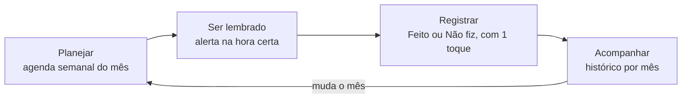

1. **Planejar:** a agenda tem compromissos com início e fim que se repetem por dia da semana (academia às 5h, aula, trabalho, culto). Cada agenda vale para um período, por exemplo novembro. Em dezembro, duplique e ajuste só o que mudou. Cada dia tem um espaço livre para encaixar outra atividade.
2. **Ser lembrado:** alertas locais com o app fechado, com antecedência por compromisso e o despertar do dia.
3. **Registrar:** toque em "Feito" na agenda ou direto na notificação. Também há "Não fiz" e Desfazer. O histórico só conta o que foi marcado.
4. **Acompanhar:** painel por atividade e por mês ("quantas vezes fui à academia em janeiro"), com comparação entre meses.

O passado nunca é reescrito: editar a agenda de dezembro não muda a contagem de novembro.

---

## 2. Telas

### App (capturas do app rodando, novo visual)

| Hoje | Hoje (escuro) | Agenda |
|---|---|---|
| 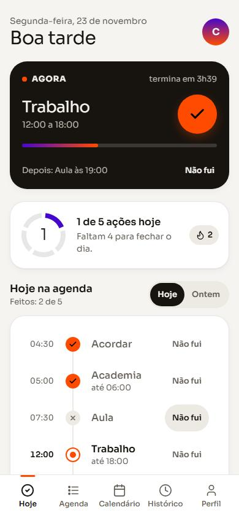 |  | 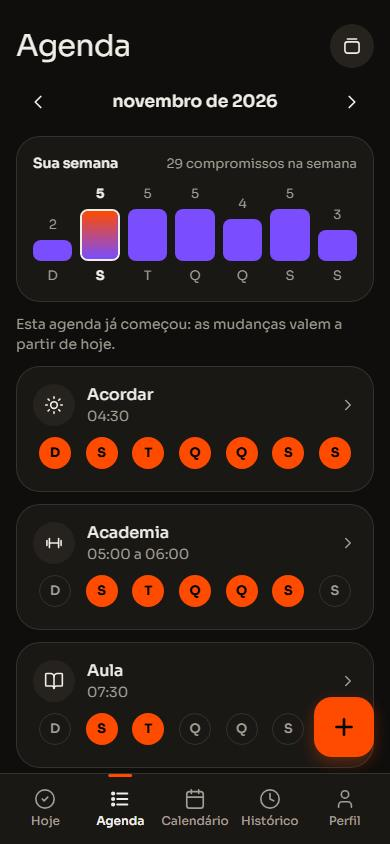 |

| Novo compromisso | Calendário | Histórico | Perfil |
|---|---|---|---|
|  | 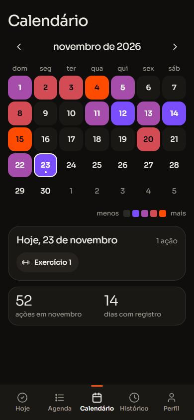 |  |  |

O que mudou no novo visual:
- **Hoje:** o compromisso de agora (ou o próximo) fica no topo com um botão grande de concluir. Os compromissos do dia viram uma linha do tempo: tocar na bolinha marca Feito, e deslizar para a direita marca Feito, para a esquerda Não fui. Os hábitos se registram com 1 toque nos chips, com Desfazer no aviso.
- **Agenda:** "Sua semana" mostra quantos compromissos caem em cada dia; os dias de cada compromisso são bolinhas que ligam e desligam com um toque; o botão "+" flutua no canto.
- **Novo compromisso:** atividades em chips com busca, horários em blocos grandes, lembrete com menos e mais e o resumo do que vai ser salvo.
- **Calendário e Histórico:** dias pintados pela intensidade, total do mês com a comparação com o mês anterior e barras por semana.
- **Em todo o app:** retorno tátil nos toques (Android e iOS), marcador da aba que desliza e controles segmentados animados, respeitando "reduzir movimento".

As capturas usam os dados de exemplo do modo de desenvolvimento, com o relógio do navegador fixado numa segunda-feira às 14:20.

### Design (canvas v2)

| | | |
|---|---|---|
| 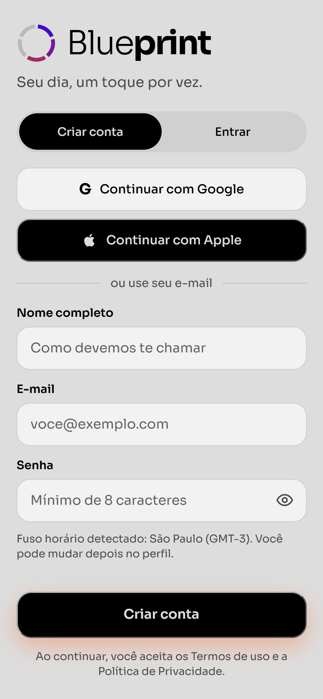 | 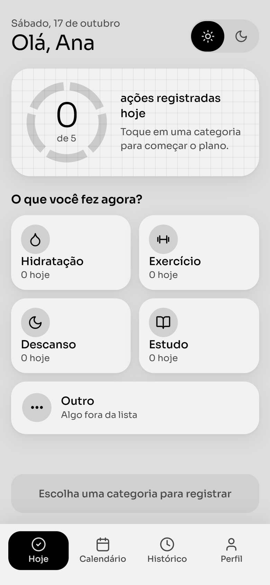 | 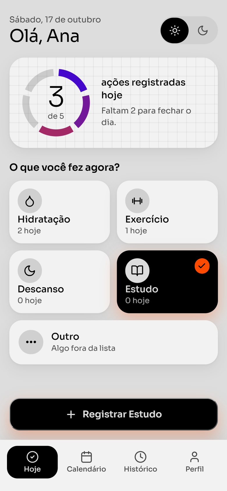 |
| 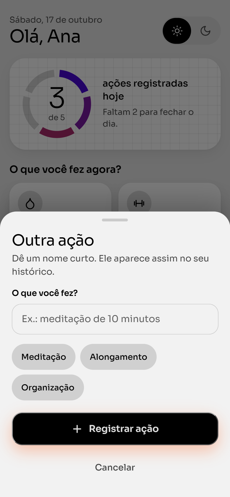 | 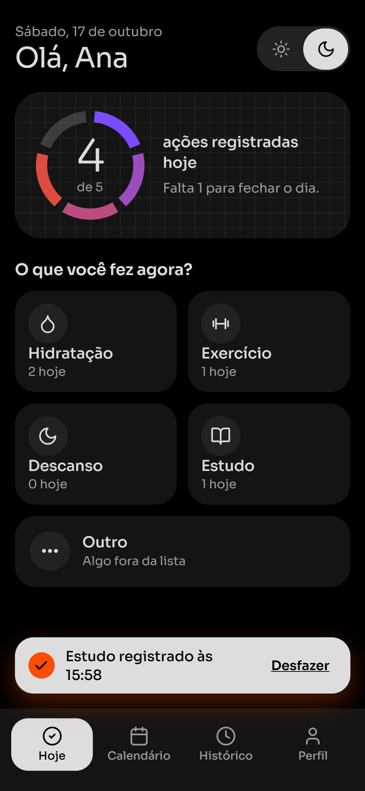 | 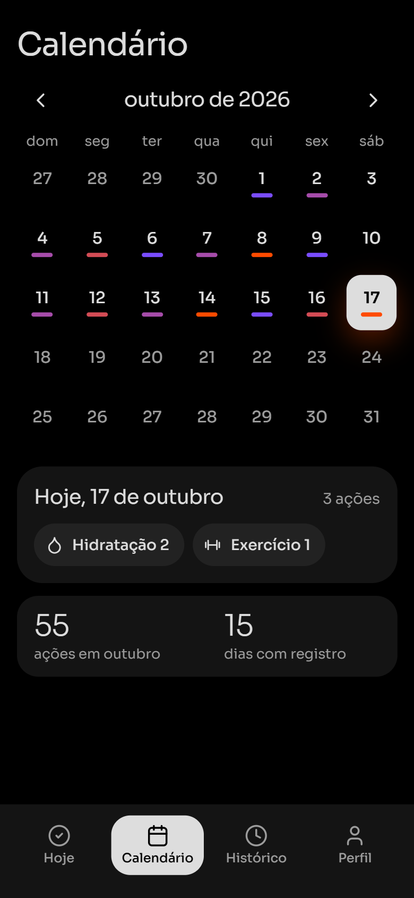 |
| 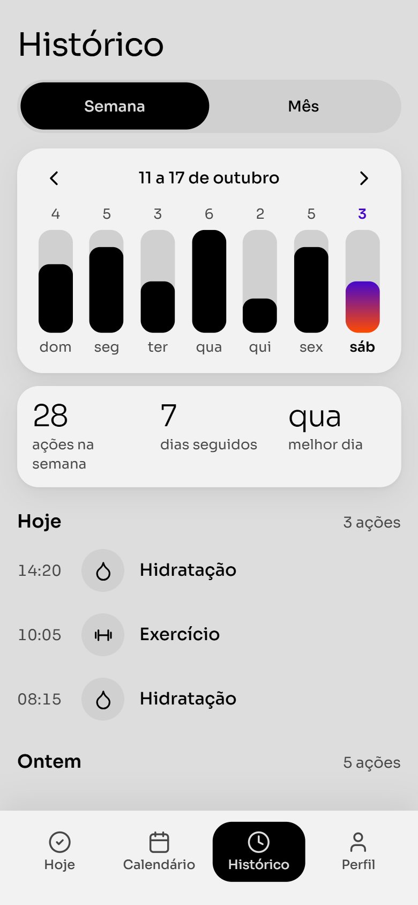 | 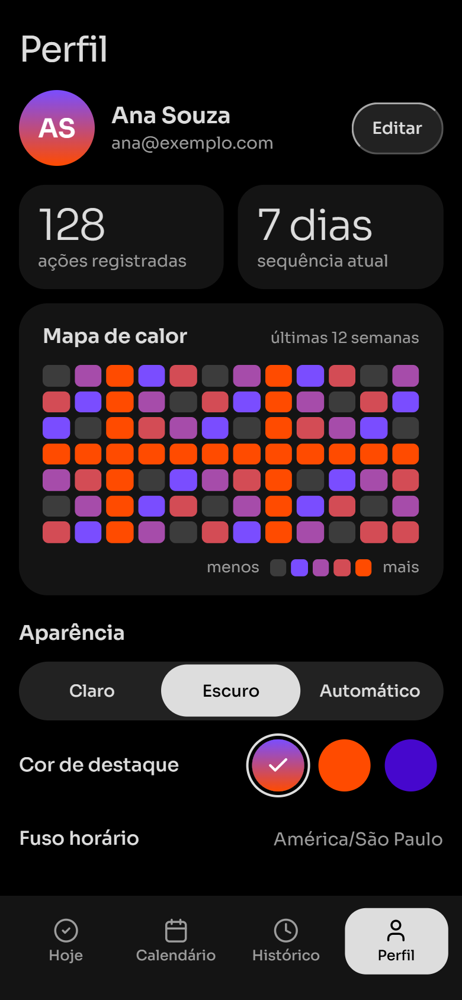 | |

O canvas acima é a v2 original. O novo visual das capturas segue o canvas de sugestões: https://claude.ai/artifact/X7PDSqziagmNYHRughMKHp (privado até o dono compartilhar).

---

## 3. Estado atual

| Área | Situação |
| :--- | :--- |
| **App (branch `main`)** | Expo SDK 57 + TypeScript. Home de hábitos com anel de progresso, "Outro" com nome, toast com Desfazer e animações; **Agenda semanal** (compromissos recorrentes e avulsos, agendas por período); Calendário, Histórico e Perfil; tema claro, escuro e automático; dados salvos no aparelho. |
| **Agenda semanal (etapa 1)** | Concluída e integrada na `main`, com testes automatizados (261 testes). Especificação em [`docs/superpowers/specs/2026-11-15-agenda-semanal-design.md`](docs/superpowers/specs/2026-11-15-agenda-semanal-design.md). |
| **Login e nuvem (etapa 5)** | Código integrado na `feat/nilton`: entrar, criar conta, "Esqueci a senha" e sair (e-mail e senha), cartão "Conta" no Perfil e sincronização offline-first por mesclagem de três vias, testada com uma nuvem falsa. Migrações 002 e 003 aplicadas pelo dono em 2026-11-22. Falta conferir no aparelho contra o Supabase real. A foto do perfil ainda fica só no aparelho. |
| **Privacidade (LGPD) e lembretes** | Aceite dos Termos de Uso e da Política de Privacidade no cadastro, textos no app (Perfil > Privacidade) e na landing, exclusão da conta e dos dados pelo app (migração 003, aplicada). "Avisar antes" por toque, também nos avulsos, com a permissão pedida só ao salvar um aviso. O APK não leva dados de exemplo. Os textos legais ainda precisam de revisão jurídica: [`docs/09`](docs/09-lgpd-pendencias-juridicas.md). |
| **Novo visual** | Home com "Agora" e linha do dia com gesto, registro rápido com 1 toque, Agenda com carga da semana, formulário refeito, Calendário pintado por intensidade e Histórico do mês com destaque e barras por semana. Dependências: `expo-haptics` e `react-native-gesture-handler`. |
| **APK** | `eas.json` pronto (`buildType: apk`). Alertas só podem ser validados em APK ou development build, não no Expo Go. |

A branch `main` recebe o código quando cada etapa estiver concluída. Na visualização web (`npx expo start --web`) as animações de entrada ficam desligadas, para a tela se ajustar ao redimensionar a janela; no celular elas continuam.

---

## 4. Roteiro

- [x] **Base (etapas 0 a 6 anteriores):** projeto Expo com TypeScript, fundação visual, Home, anel e animações, navegação, Calendário, Perfil e persistência local.
- [x] **1. Agenda semanal:** compromissos com início e fim, agendas por período, espaço livre, editar e duplicar para o mês seguinte.
- [x] **2. Registro:** "Feito" e "Não fiz" com Desfazer, e a Home com os compromissos de hoje.
- [x] **3. Alertas:** despertar, antecedência por compromisso, botão "Feito" na notificação, permissões do Android e economia de bateria.
- [x] **4. Painel de histórico:** contagem por atividade e por mês, comparação entre meses, detalhe dos dias.
- [ ] **5. Supabase:** login, acesso por usuário (RLS), sincronização que funciona sem internet, subida dos dados locais. O SQL é revisado e aplicado pelo dono em um projeto de desenvolvimento.
  - [x] Login por e-mail e senha, sair, "Esqueci a senha" e o cartão "Conta" no Perfil.
  - [x] Sincronização offline-first (mesclagem de três vias, troca de conta, sair mantendo ou apagando), com testes automatizados.
  - [x] Aplicar as migrações 002 (tabela `registros`) e 003 (aceite dos termos, aviso nos avulsos e exclusão da conta).
  - [ ] Conferir no aparelho: entrar em dois aparelhos e ver o mesmo histórico.
  - [ ] Foto do perfil na nuvem (bucket `avatares`), login com Google e Apple.
- ~~**6. Gamificação e ganhos visuais**~~: retirada do plano pelo dono em 2026-11-21.
- [ ] **7. APK de release:** checklist de segurança feito e configuração pronta ([`docs/08-release-apk.md`](docs/08-release-apk.md)); migrações aplicadas e variáveis criadas no EAS; falta conferir o APK `preview` no aparelho.

As etapas 1 a 4 funcionam só no aparelho. O Supabase só é necessário a partir da etapa 5.

---

## 5. Tecnologia

| Camada | Tecnologia |
| :--- | :--- |
| Mobile | React Native 0.86 + Expo SDK 57, TypeScript |
| Navegação | React Navigation 7 (abas e pilha) |
| Visual | `react-native-svg`, `react-native-reanimated` 4, fonte Sora (Nohemi quando licenciada) |
| Dados no aparelho | AsyncStorage com formato versionado e migração |
| Alertas | `expo-notifications` (etapa 3) |
| Nuvem e login | Supabase (PostgreSQL + Auth, `sa-east-1`) com RLS por usuário (etapa 5) |
| Qualidade | ESLint, Prettier, TypeScript estrito, Jest + Testing Library |
| Distribuição | Expo EAS Build (`.apk`) |

---

## 6. Como rodar

```bash
npm install
cp .env.example .env        # URL e chave publishable do Supabase (sem elas, o app funciona só no aparelho)
npx expo start              # leia o QR code com o Expo Go (SDK 57)
```

Verificações:

```bash
npm run typecheck
npm run lint
npm test
```

Para testar alertas é preciso um build instalado (perfil `development` ou `preview` do `eas.json`):

```bash
eas build -p android --profile preview
```

---

## 7. Organização do código

```text
src/
├── domain/        # Regras puras e testadas (ações, datas, estatísticas, agenda)
├── data/          # Repositórios no aparelho (AsyncStorage) e a base da sincronização
├── sincronizacao/ # Mesclagem de três vias, conversores app <-> banco e portas da nuvem (puros)
├── hooks/         # Estado compartilhado (useAcoes, useAgenda, useConta, useSincronizacao)
├── theme/         # ThemeProvider: claro, escuro, automático e cor de destaque
├── styles/        # Tokens de design (theme.ts) e cores
├── ui/            # Componentes base (Screen, Card, Text, Icon, SegmentedControl)
├── components/    # Componentes do app (anel, cartões, sheet, toast, gráficos, agenda)
├── screens/       # Telas
├── navigation/    # Abas e pilha
└── services/      # Cliente Supabase e adaptadores (autenticação e nuvem)
supabase/migrations/ # SQL revisado e aplicado pelo dono (001, 002 e 003 aplicadas)
```

---

## 8. Documentação

1. [01 Visão do Produto, Público-Alvo e Escopo](docs/01-visao-produto-mvp.md)
2. [02 Arquitetura, Supabase, Segurança e APK](docs/02-arquitetura-supabase-apk.md)
3. [03 Guia das Telas](docs/03-guia-telas-figma.md)
4. [04 Design Tokens, Motion e Acessibilidade](docs/04-design-tokens-e-motion.md)
5. [05 Funcionalidades, Fluxos e Critérios de Aceite](docs/05-funcionalidades-e-fluxos.md)
6. [06 Roteiro de Desenvolvimento](docs/06-roteiro-claude-code.md)
7. [08 Release do APK](docs/08-release-apk.md)
8. [09 LGPD: pendências para revisão jurídica](docs/09-lgpd-pendencias-juridicas.md)
9. [Especificações](docs/superpowers/specs/): a agenda semanal (2026-11-15) é a vigente; a de plano diário (2026-10-18) foi substituída.

Os documentos 01 a 06 ainda descrevem o app de hábitos e serão atualizados ao fim de cada etapa.

---

## 9. Licenças

- **Nohemi** (Pangram Pangram) tem licença gratuita para uso pessoal e paga para uso comercial. Confirme a licença antes de distribuir o `.apk`. Até lá o app usa **Sora** (Google Fonts, OFL).
