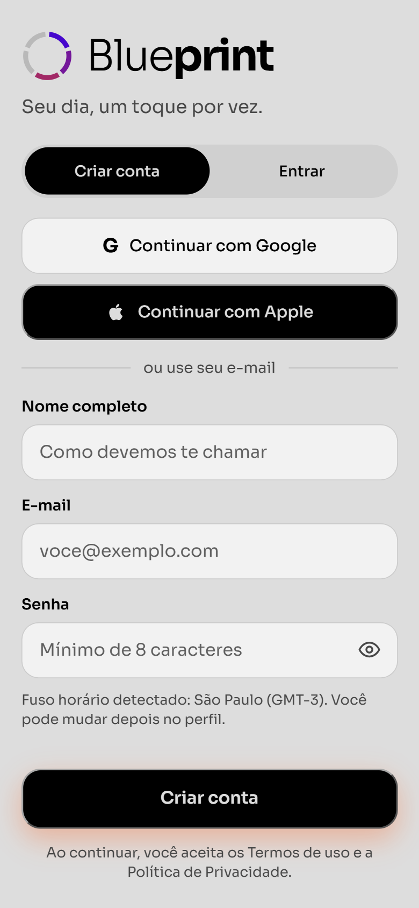
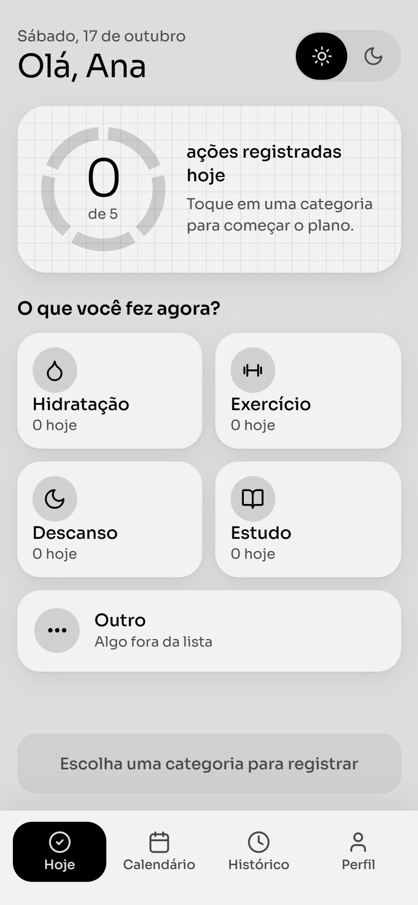
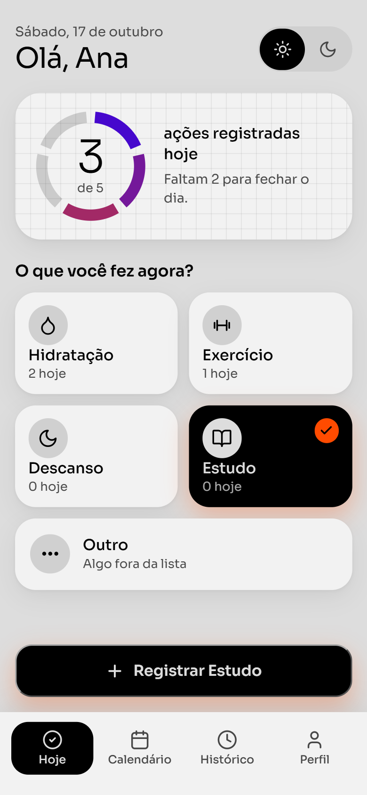
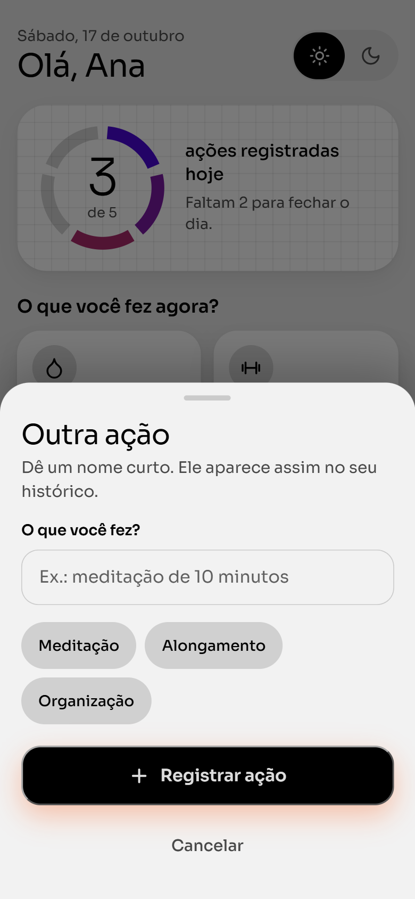
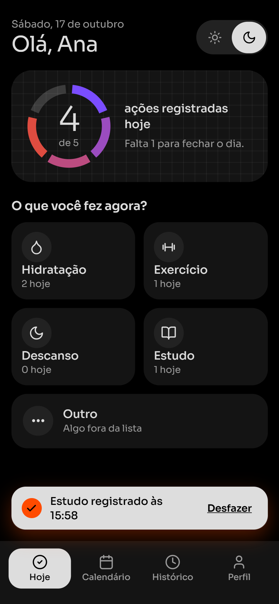
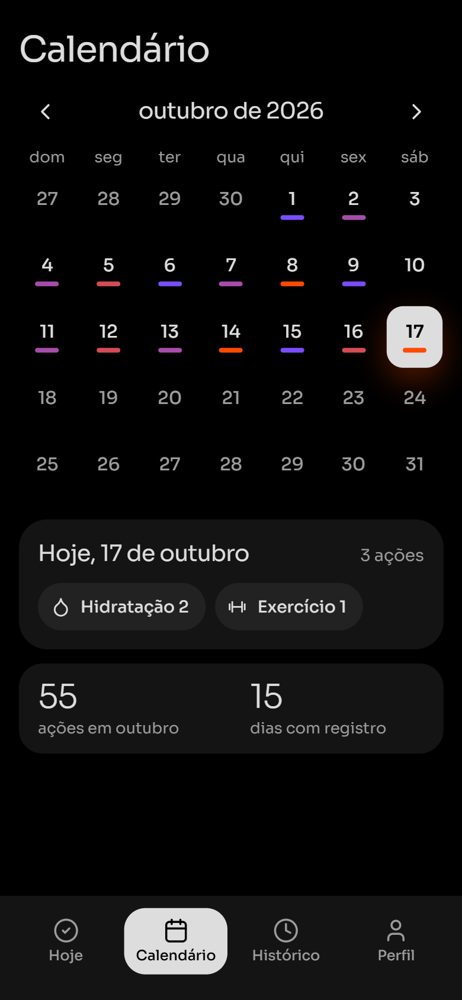
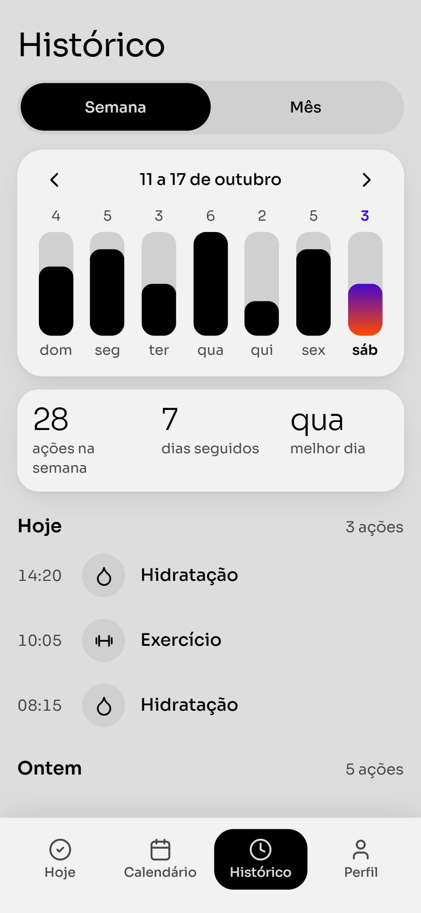
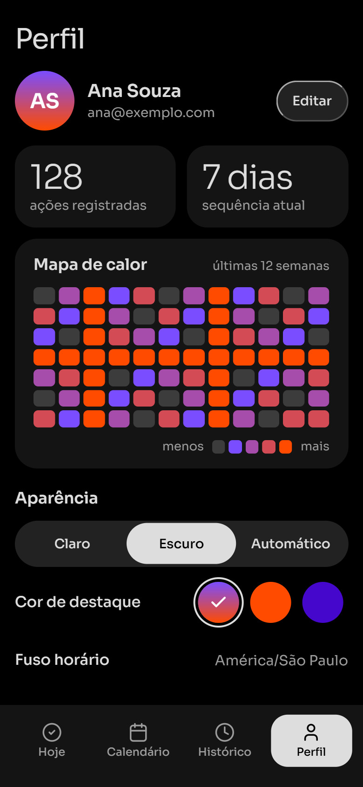
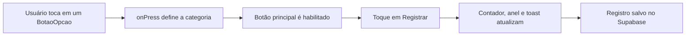

# 📐 Blueprint: Plano de Ação Claro e Estruturado

> Registre um hábito com 1 toque. Hidratação, Exercício, Descanso, Estudo e Outro, com progresso do dia, calendário e histórico.

**🎨 Canvas editável das telas (v2):** https://claude.ai/artifact/Cae8a8KKv5bRKpx234Zh3h
O link é privado até o dono do canvas compartilhar pelo botão *Share*. O código-fonte das 8 pranchas também está versionado em [`docs/design/canvas-source/`](docs/design/canvas-source/).

---

## 📱 Telas do MVP

| | | |
|---|---|---|
|  |  |  |
|  |  |  |
|  |  | |

---

## 📌 Estado atual do projeto

| Camada | Situação |
| :--- | :--- |
| **Documentação e design (v2)** | Pronta: 8 telas, paleta da marca, tipografia, motion, funcionalidades e modelo de dados. |
| **Código em `src/`** | Uma tela (`BlueprintHomeScreen`) com seleção de categoria e contador em memória (`useState`). Sem persistência, sem tema claro/escuro ativo, sem navegação. |
| **Supabase** | Tabela `blueprint_actions` criada. Integração no app ainda não feita. Policies atuais são abertas, veja o [alerta de segurança](docs/02-arquitetura-supabase-apk.md#alerta-de-segurança-policies-abertas). |
| **APK** | `eas.json` configurado com `buildType: apk`. Build será feito após a Fase 2. |

As telas e funções descritas abaixo são o alvo das Fases 2 a 4. A lista completa, com status de cada uma, está em [`docs/05-funcionalidades-e-fluxos.md`](docs/05-funcionalidades-e-fluxos.md).

---

## 🎯 1. Visão Geral do Projeto

O **Blueprint** é uma aplicação mobile leve e sem fricção para o planejamento diário e o acompanhamento rápido de hábitos essenciais (**Hidratação**, **Exercício**, **Descanso**, **Estudo** e demandas personalizadas via **Outro**).

A identidade visual da v2 usa a paleta da marca: **Preto `#000000`**, **Off White `#DDDDDD`**, **Laranja `#FF4B00`** e **Roxo índigo `#4607CD`**, com um **gradiente vertical roxo para laranja** como assinatura. Há modo claro, modo escuro e modo automático. A tipografia é **Nohemi** (ExtraLight a Bold).

O princípio de produto continua o mesmo, *"One Screen, One Job"*: transformar a intenção em ação com **1 toque**, feedback visual imediato e sincronização em nuvem.

---

## 👥 2. Público-Alvo, Problema e Objetivos

### Público-Alvo
- **Primário:** estudantes universitários e jovens profissionais (18 a 35 anos) que conciliam estudos, trabalho e vida pessoal.
- **Secundário:** usuários de qualquer país ou fuso horário que queiram uma rotina equilibrada em um app direto ao ponto (4G/5G ou Wi-Fi).

### O Problema
Aplicativos de produtividade e saúde falham por **excesso de complexidade**: configurações demoradas, menus poluídos e muitos campos antes do primeiro registro. Isso gera fadiga de decisão e abandono precoce.

### Objetivos de Resolução
1. **Onboarding rápido:** cadastro com Nome, E-mail e Senha, ou 1 toque com **Google** e **Apple**. O fuso horário é detectado automaticamente.
2. **Interação de 1 toque:** registrar a ação tocando em cartões amplos (`BotaoOpcao`), com o botão de registro só habilitado quando há categoria escolhida.
3. **Visão do dia, do mês e da semana:** anel de progresso, calendário mensal e histórico semanal, na barra inferior de 4 abas (Hoje, Calendário, Histórico, Perfil).
4. **Conforto visual:** modo claro, escuro ou automático, com animações suaves que respeitam a opção "reduzir movimento" do sistema.
5. **Uso real e gratuito:** instalação direta em Android via `.apk` (Expo EAS Build) e persistência em nuvem via Supabase (PostgreSQL).

---

## 🛠️ 3. Stack Tecnológica

| Camada | Tecnologia | Papel no projeto | Situação |
| :--- | :--- | :--- | :--- |
| **Mobile** | React Native + Expo | Interface nativa (`View`, `Text`, `Pressable`, `StyleSheet`). | Em uso |
| **Estado** | React Hooks (`useState`) | Categoria selecionada, contador do dia, tema. | Em uso (categoria e contador) |
| **Navegação** | Biblioteca de abas (ex.: `@react-navigation/bottom-tabs` ou `expo-router`) | Barra inferior com 4 abas. | Planejado (Fase 3) |
| **Animação** | `react-native-reanimated` | Entradas em cascata, anel, barras, bottom sheet, toast. | Planejado (Fase 2) |
| **Gráficos** | `react-native-svg` | Anel de progresso segmentado e gráfico semanal. | Planejado (Fase 2) |
| **Fonte** | `expo-font` + Nohemi | Tipografia da marca. | Planejado (Fase 2) |
| **UI / UX** | Canvas editável (Claude) e SVG UI Kit v1 | Prototipação das telas. | v2 pronto |
| **Banco e Auth** | Supabase (PostgreSQL + Auth), `sa-east-1` | Dados na nuvem e autenticação. | Tabela criada, app não integrado |
| **Distribuição** | Expo EAS Build (`.apk`) | Instalador Android gratuito. | `eas.json` pronto |

---

## 🏗️ 4. Arquitetura do Repositório

```text
blueprint-app/
├── README.md
├── eas.json                               # Expo EAS: gera .APK
├── .env.example                           # Variáveis do Supabase
├── docs/
│   ├── assets/
│   │   └── blueprint_mvp_screens.jpg      # Painel das telas da v1 (histórico)
│   ├── design/
│   │   └── canvas-source/                 # Código-fonte das 8 pranchas da v2
│   ├── figma/
│   │   └── blueprint_ui_kit.svg           # UI Kit vetorial da v1 (histórico)
│   ├── 01-visao-produto-mvp.md            # Público, personas, dores e escopo
│   ├── 02-arquitetura-supabase-apk.md     # Arquitetura, Supabase, segurança e APK
│   ├── 03-guia-telas-figma.md             # As 8 telas da v2
│   ├── 04-design-tokens-e-motion.md       # Cores, tipografia, sombras, motion e acessibilidade
│   └── 05-funcionalidades-e-fluxos.md     # Funções do app, regras e critérios de aceite
└── src/
    ├── components/
    │   ├── BotaoOpcao.js
    │   └── BotaoAcao.js
    ├── screens/
    │   └── BlueprintHomeScreen.js
    ├── services/
    │   ├── supabaseSchema.sql
    │   └── migrations/
    │       └── 002_auth_e_rls_PROPOSTA.sql   # Proposta, ainda não aplicada
    └── styles/
        └── theme.js                           # Tokens da v1 (a atualizar na Fase 2)
```

---

## 🔄 5. Fluxo de Interação



---

## 📖 6. Documentação Detalhada

1. 📄 [01 Visão do Produto, Público-Alvo e Escopo](docs/01-visao-produto-mvp.md)
2. 🏗️ [02 Arquitetura, Supabase, Segurança e APK](docs/02-arquitetura-supabase-apk.md)
3. 🎨 [03 Guia das 8 Telas da v2](docs/03-guia-telas-figma.md)
4. 🧩 [04 Design Tokens, Motion e Acessibilidade](docs/04-design-tokens-e-motion.md)
5. ⚙️ [05 Funcionalidades, Fluxos e Critérios de Aceite](docs/05-funcionalidades-e-fluxos.md)

---

## 📱 7. Telas da v2

| # | Tela | Modo | O que mostra |
| :-: | :--- | :--- | :--- |
| 1 | Cadastro e login | Claro | Google, Apple, e-mail, fuso detectado. |
| 2 | Home, estado inicial | Claro | Anel 0 de 5, categorias, botão desabilitado. |
| 3 | Home, categoria ativa | Claro | Estudo selecionado, botão "Registrar Estudo". |
| 4 | Home, opção Outro | Claro | Bottom sheet com nome livre e sugestões. |
| 5 | Home, após registrar | Escuro | Toast "Estudo registrado" com Desfazer. |
| 6 | Calendário | Escuro | Mês com intensidade por dia e resumo do dia. |
| 7 | Histórico | Claro | Gráfico da semana, resumo e lista por horário. |
| 8 | Perfil | Escuro | Mapa de calor, aparência, cor de destaque, conta. |

Os nomes, datas e números das telas são dados de exemplo. Detalhes de cada tela em [`docs/03-guia-telas-figma.md`](docs/03-guia-telas-figma.md).

---

## 🗺️ 8. Roadmap

- [x] **Fase 1 (Planejamento, arquitetura e UI/UX):** produto, escopo, arquitetura do repositório, banco no Supabase (`sa-east-1`), componentes base.
- [x] **Fase 1.1 (Redesenho v2):** 8 telas, paleta da marca, tipografia Nohemi, calendário, motion, modo claro e escuro, documentação de tokens e funcionalidades.
- [ ] **Fase 2 (Desenvolvimento core):** tokens v2 em `theme.js`, tema claro/escuro, anel de progresso, validação do botão de registrar, bottom sheet do "Outro", animações.
- [ ] **Fase 3 (Calendário, histórico e navegação):** barra de 4 abas, calendário mensal, histórico semanal com `FlatList`, mapa de calor.
- [ ] **Fase 4 (Autenticação, nuvem e APK):** login Google/Apple/e-mail, migração de segurança (RLS por usuário), integração Supabase, offline-first e publicação do `.apk`.

---

## ⚖️ 9. Notas de licença

- **Nohemi** (Pangram Pangram) tem licença gratuita para uso pessoal e paga para uso comercial. Confirme a licença antes de distribuir o `.apk`. Enquanto isso, os mockups usam **Sora** (Google Fonts, OFL) como substituta visual.
