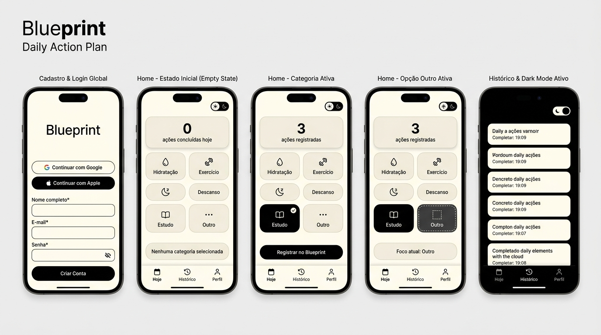
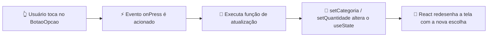

# 📐 Blueprint — Plano de Ação Claro e Estruturado



---

## 🎯 1. Visão Geral do Projeto

O **Blueprint** é uma aplicação mobile leve, intuitiva e sem fricção voltada para o planejamento diário e acompanhamento rápido de hábitos essenciais (**Hidratação**, **Exercício**, **Descanso**, **Estudo** e demandas personalizadas via **Outro**).

Projetado com uma estética minimalista de alto contraste em **Creme (`#FFFDF2`)** e **Preto (`#000000`)** — com alternância nativa entre **Modo Claro (Light)** e **Modo Escuro (Dark)** —, o **Blueprint** aplica o princípio *"One Screen, One Job"*: transformar a intenção em ação através de **1 toque**, com feedback visual imediato e sincronização em nuvem.

---

## 👥 2. Público-Alvo, Problema e Objetivos de Resolução

### Público-Alvo
- **Primário:** Estudantes universitários e jovens profissionais (18 a 35 anos) que conciliam estudos, trabalho e vida pessoal.
- **Secundário:** Usuários em qualquer país/fuso horário que busquem construir uma rotina equilibrada usando um aplicativo direto ao ponto no celular (via 4G/5G ou Wi-Fi).

### O Problema
Aplicativos tradicionais de produtividade e saúde falham por **excesso de complexidade**: exigem configurações demoradas, menus poluídos e múltiplos campos de digitação antes mesmo de registrar a primeira tarefa. Isso gera fadiga de decisão e abandono precoce.

### Objetivos de Resolução
1. **Onboarding e Login Global Rápido:** Cadastro com campos essenciais globais (Nome, E-mail, País/Fuso, Senha) ou acesso imediato de 1 toque via **Google** e **Apple (iOS)**.
2. **Interação de 1 Toque (Zero Fricção):** Permitir que o usuário classifique e registre sua ação prioritária tocando em cartões táteis amplos (`BotaoOpcao` / `Pressable`).
3. **Conforto Visual Adaptável (Light & Dark Mode):** Paleta editorial Creme (`#FFFDF2`) e Preto (`#000000`) com chave seletora no topo da tela e barra de navegação inferior (*Bottom Navigation Bar*) na zona do polegar.
4. **Uso Real Gratuito (APK + Nuvem):** Instalação direta em celulares Android via arquivo **`.apk` (Expo EAS Build)** e persistência em nuvem via **Supabase (PostgreSQL)** em redes Wi-Fi ou dados móveis (4G/5G).

---

## 🛠️ 3. Stack Tecnológica

| Camada | Tecnologia | Papel no Projeto |
| :--- | :--- | :--- |
| **Mobile Framework** | **React Native + Expo** | Construção da interface nativa multiplataforma (`View`, `Text`, `SafeAreaView`, `Pressable`, `StyleSheet`). |
| **Gerenciamento de Estado** | **React Hooks (`useState`)** | Controle reativo da categoria selecionada, contador diário e tema visual (Light/Dark). |
| **UI / UX Design** | **Figma + SVG UI Kit** | Prototipação das 5 telas do MVP em alta definição na paleta Creme (`#FFFDF2`) e Preto (`#000000`). |
| **Banco de Dados & Auth** | **Supabase (PostgreSQL + Auth)** | Armazenamento gratuito na nuvem (`sa-east-1` - São Paulo) e suporte a autenticação global. |
| **Distribuição Android** | **Expo EAS Build (`.apk`)** | Geração gratuita do instalador `.apk` para baixar e usar diretamente nos celulares. |

---

## 🏗️ 4. Arquitetura do Repositório

```text
blueprint-app/
├── README.md                              # Visão geral, arquitetura e telas do MVP
├── eas.json                               # Configuração Expo EAS para gerar .APK gratuito
├── .env.example                           # Modelo de variáveis de ambiente do Supabase
├── .gitignore                             # Proteção de credenciais (.env) e node_modules
├── docs/                                  # 📚 Documentação de Produto, Arquitetura e Figma
│   ├── assets/
│   │   └── blueprint_mvp_screens.jpg      # Painel em alta definição das 5 telas do MVP
│   ├── figma/
│   │   └── blueprint_ui_kit.svg           # Arquivo vetorial 100% editável para importar no Figma
│   ├── 01-visao-produto-mvp.md            # Público-alvo, personas, dores e objetivos do MVP
│   ├── 02-arquitetura-supabase-apk.md     # Arquitetura React Native + Supabase + APK
│   └── 03-guia-telas-figma.md             # Especificação das 5 telas, cores (#FFFDF2 / #000000) e Figma
└── src/                                   # 💻 Estrutura Arquitetural da Aplicação
    ├── components/
    │   ├── BotaoOpcao.js                  # Componente reutilizável de categoria (Pressable)
    │   └── BotaoAcao.js                   # Componente de confirmação de ação
    ├── screens/
    │   └── BlueprintHomeScreen.js         # Tela principal do MVP (Seletor + Contador)
    ├── services/
    │   └── supabaseSchema.sql             # Script SQL da tabela para o Supabase
    └── styles/
        └── theme.js                       # Design tokens (Paleta Creme #FFFDF2 & Preto #000000)
```

---

## 🔄 5. Fluxo de Interação da Interface



---

## 📖 6. Documentação Detalhada e Arquivos do Figma

1. 📄 **[01 - Visão do Produto, Público-Alvo e Escopo do MVP](docs/01-visao-produto-mvp.md)**
2. 🏗️ **[02 - Arquitetura Técnica, Supabase Cloud e Geração de APK](docs/02-arquitetura-supabase-apk.md)**
3. 🎨 **[03 - Guia das 5 Telas do MVP, Paleta Creme/Preto e Especificação Figma](docs/03-guia-telas-figma.md)**
4. ✏️ **[UI Kit Vetorial Editável para o Figma (`blueprint_ui_kit.svg`)](docs/figma/blueprint_ui_kit.svg)**

---

## 🗺️ 7. Roadmap do Projeto

- [x] **Fase 1 (Planejamento, Arquitetura & UI/UX):** Definição do produto, documentação de escopo, arquitetura do repositório, provisionamento do banco no Supabase (`sa-east-1`), design das 5 telas do MVP (Light/Dark + Auth Global) e estrutura de componentes.
- [ ] **Fase 2 (Desenvolvimento Core):** Implementação executável completa dos componentes interativos, alternância Light/Dark e contador diário.
- [ ] **Fase 3 (Histórico e Listagem):** Exibição do histórico de ações diárias registradas utilizando `FlatList` e navegação via *Bottom Bar*.
- [ ] **Fase 4 (Autenticação Global, Persistência Cloud e Release APK):** Login com Google/Apple, integração ativa com o **Supabase** e publicação do arquivo **`.apk`**.
