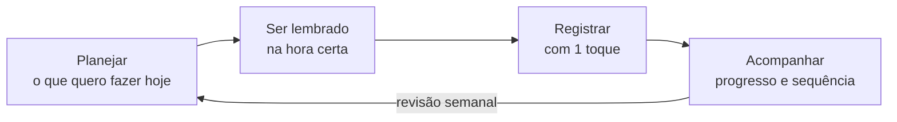

# 📐 Blueprint: seu dia planejado, lembrado e cumprido

> Monte o plano do seu dia em um minuto, receba lembretes na hora certa e marque cada atividade com 1 toque. Hidratação, Exercício, Descanso, Estudo e o que mais você quiser, com progresso, calendário e histórico. Em português, sem limite de hábitos.

**🎨 Canvas editável das telas (v2):** https://claude.ai/artifact/Cae8a8KKv5bRKpx234Zh3h
O link é privado até o dono do canvas compartilhar pelo botão *Share*. O código-fonte das 8 pranchas está em [`docs/design/canvas-source/`](docs/design/canvas-source/).

---

## 🎯 1. A proposta

Ninguém abre um app para marcar algo que não planejou. Por isso o Blueprint segue um ciclo simples:



1. **Planejar:** no primeiro acesso, a pessoa monta o dia escolhendo atividades, quantidade ("8 copos de água"), uma versão mínima para dias difíceis ("2 copos") e quando quer ser lembrada (horários fixos, intervalo ou sem horário). Cada manhã dá para ajustar só aquele dia.
2. **Ser lembrado:** lembretes que só avisam o que ainda falta, respeitam o horário de silêncio e trazem contexto ("Faltam 3 copos de água").
3. **Registrar:** 1 toque na Home ou direto na notificação. Errou? Tem Desfazer.
4. **Acompanhar:** anel do plano do dia, calendário, histórico, mapa de calor, sequência com folga semanal e revisão no domingo.

### O que aprendemos com a concorrência
Apps de hábitos bem avaliados perdem usuários quando **limitam hábitos no plano gratuito**, **perdem dados**, **não deixam desfazer** e **não falam português**. O Blueprint nasce em português, sem limite artificial de atividades, com dados salvos no aparelho de forma versionada e com Desfazer em todo registro.

---

## 📱 2. Telas

| | | |
|---|---|---|
|  |  |  |
|  |  |  |
|  |  | |

As telas do plano ("Monte seu dia", "Plano de hoje", "Seu dia" e "Meu plano") estão em desenvolvimento e entram aqui quando prontas.

---

## 📌 3. Estado atual

| Área | Situação |
| :--- | :--- |
| **App (branch `develop`)** | Expo SDK 57 + TypeScript. Home com anel de progresso, categorias, "Outro" com nome, toast com Desfazer e animações; Calendário, Histórico e Perfil; tema claro, escuro e automático; cor de destaque; dados salvos no aparelho. |
| **Plano diário (Parte 1)** | Em desenvolvimento. Especificação em [`docs/superpowers/specs/`](docs/superpowers/specs/). |
| **Login e nuvem (Etapa 7)** | Pausada na branch `feat/etapa-7-supabase-login`: login por e-mail, sincronização offline-first e migração de segurança revisada (RLS por usuário). |
| **APK** | `eas.json` pronto (`buildType: apk`). Build ao final das partes 1 a 3. |

A branch `main` recebe o código quando cada parte estiver testada no aparelho.

---

## 🗺️ 4. Roteiro

- [x] **Etapas 0 a 6:** projeto Expo com TypeScript, fundação visual, Home funcional, anel e animações, navegação e Histórico, Calendário e Perfil, persistência local.
- [ ] **Parte 1, Plano:** "Monte seu dia", plano base com ajuste do dia, Home "Plano de hoje", versão mínima, editar o plano.
- [ ] **Parte 2, Lembretes:** notificações locais só do que falta, horário de silêncio, botão "Feito" na notificação, fechamento do dia.
- [ ] **Parte 3, Motivação:** sequência com 1 folga por semana, comemorações e conquistas, revisão semanal.
- [ ] **Etapa 7, Conta e nuvem:** login por e-mail (depois Google e Apple), sincronização com Supabase.
- [ ] **Etapa 8, APK:** build e checklist de release.
- [ ] **Fase 2:** widget na tela inicial e metas em dupla.

---

## 🛠️ 5. Tecnologia

| Camada | Tecnologia |
| :--- | :--- |
| Mobile | React Native 0.86 + Expo SDK 57, TypeScript |
| Navegação | React Navigation 7 (abas e pilha) |
| Visual | `react-native-svg`, `react-native-reanimated` 4, fonte Sora (Nohemi quando licenciada) |
| Dados no aparelho | AsyncStorage com formato versionado e migração |
| Nuvem e login | Supabase (PostgreSQL + Auth, `sa-east-1`) com RLS por usuário |
| Lembretes | `expo-notifications` (Parte 2) |
| Qualidade | ESLint, Prettier, TypeScript estrito, Jest + Testing Library |
| Distribuição | Expo EAS Build (`.apk`) |

---

## 🚀 6. Como rodar

```bash
npm install
cp .env.example .env        # preencha com os dados do Supabase (opcional até a Etapa 7)
npx expo start              # leia o QR code com o Expo Go (SDK 57)
```

Verificações:

```bash
npm run typecheck
npm run lint
npm test
```

---

## 🏗️ 7. Organização do código

```text
src/
├── domain/        # Regras puras e testadas (ações, datas, estatísticas, plano)
├── data/          # Repositórios: AsyncStorage hoje, Supabase na Etapa 7
├── hooks/         # Estado compartilhado (useAcoes, usePlano)
├── theme/         # ThemeProvider: claro, escuro, automático e cor de destaque
├── styles/        # Tokens de design (theme.ts) e cores
├── ui/            # Componentes base (Screen, Card, Text, Icon, SegmentedControl)
├── components/    # Componentes do app (anel, cartões, sheet, toast, gráficos)
├── screens/       # Telas
├── navigation/    # Abas e pilha
└── services/      # Supabase e migrações SQL
```

---

## 📖 8. Documentação

1. 📄 [01 Visão do Produto, Público-Alvo e Escopo](docs/01-visao-produto-mvp.md)
2. 🏗️ [02 Arquitetura, Supabase, Segurança e APK](docs/02-arquitetura-supabase-apk.md)
3. 🎨 [03 Guia das Telas](docs/03-guia-telas-figma.md)
4. 🧩 [04 Design Tokens, Motion e Acessibilidade](docs/04-design-tokens-e-motion.md)
5. ⚙️ [05 Funcionalidades, Fluxos e Critérios de Aceite](docs/05-funcionalidades-e-fluxos.md)
6. 🧭 [06 Roteiro de Desenvolvimento](docs/06-roteiro-claude-code.md)
7. 📝 [Especificações das partes](docs/superpowers/specs/)

---

## ⚖️ 9. Licenças

- **Nohemi** (Pangram Pangram) tem licença gratuita para uso pessoal e paga para uso comercial. Confirme a licença antes de distribuir o `.apk`. Até lá o app usa **Sora** (Google Fonts, OFL).
