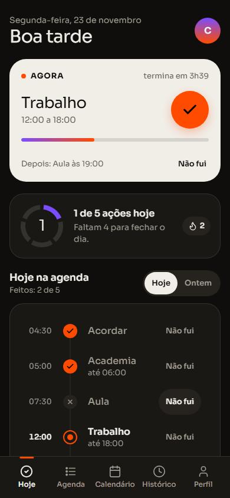
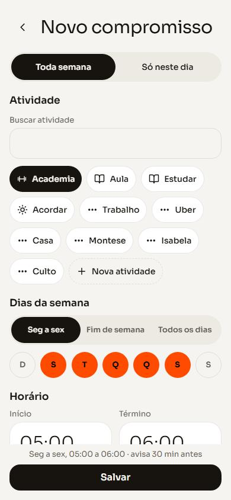
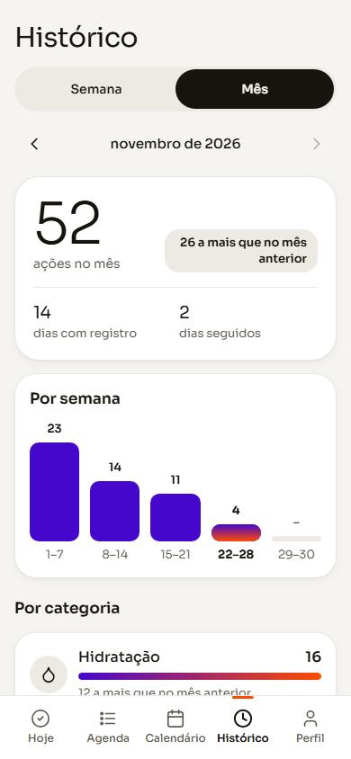
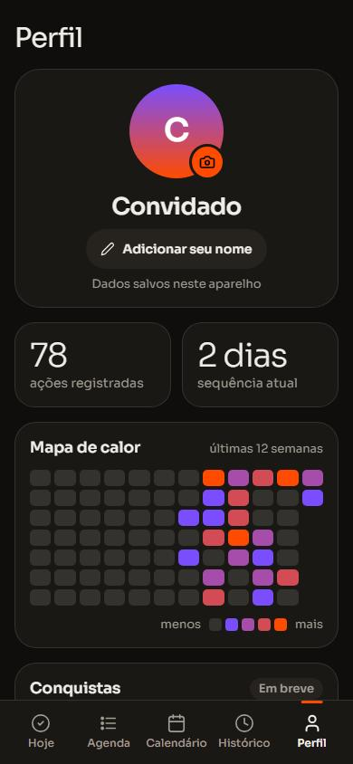
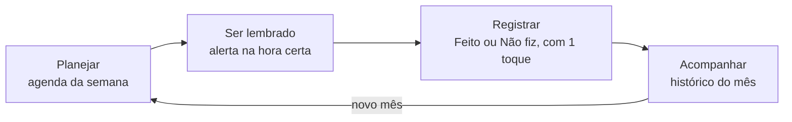
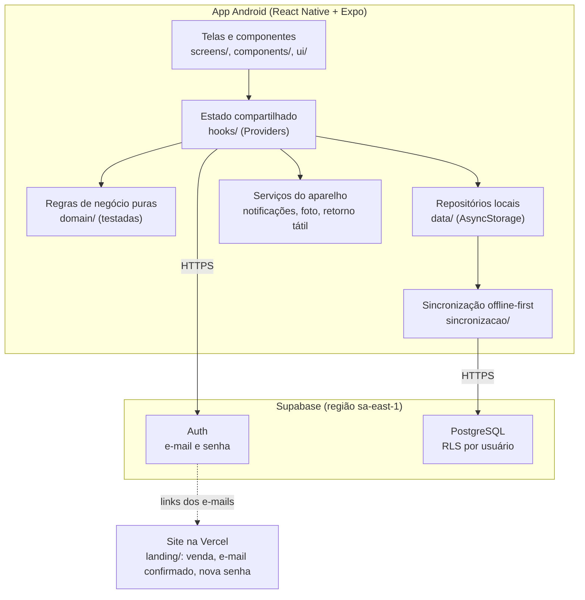

# Blueprint: sua semana organizada, lembrada e cumprida

> App Android em português para montar a agenda da semana, ser lembrado na hora certa, marcar o que fez com 1 toque e ver, no fim do mês, o que de fato cumpriu. Funciona sem internet e guarda os dados na nuvem quando você cria uma conta.

**Baixar o app:** [última versão do APK](https://github.com/roseniltonlopes/blueprint-app/releases/latest) · **Site:** [blueprint-app-landing.vercel.app](https://blueprint-app-landing.vercel.app)

| Hoje | Hoje (escuro) | Agenda |
|---|---|---|
|  |  |  |

| Novo compromisso | Calendário | Histórico | Perfil |
|---|---|---|---|
|  |  |  |  |

---

## 1. O problema que o app resolve

Quem tem a semana cheia (trabalho, aula, academia, igreja, família) costuma planejar no papel ou de cabeça. Acontecem três coisas:

1. **Esquece compromissos**, porque nada avisa na hora.
2. **Perde a noção do que cumpriu**: no fim do mês não sabe quantas vezes foi à academia ou quantas aulas perdeu.
3. **Refaz a agenda do zero** todo mês, mesmo quando quase nada mudou.

O Blueprint resolve isso com um ciclo simples:



- **Planejar:** cada compromisso tem horário e se repete nos dias da semana escolhidos. A agenda vale para um período (por exemplo, novembro) e pode ser duplicada para o mês seguinte.
- **Ser lembrado:** alertas no celular mesmo com o app fechado, com a antecedência que você escolher.
- **Registrar:** um toque em "Feito" (na tela ou direto na notificação), ou "Não fiz". Errou? Desfazer.
- **Acompanhar:** quantas vezes fez cada atividade no mês, comparação com o mês anterior e calendário pintado pela intensidade.

O passado não é reescrito: mudar a agenda de dezembro não altera o que foi registrado em novembro.

## 2. Principais funções

| Tela | O que faz |
| :--- | :--- |
| **Hoje** | Mostra o compromisso de agora (ou o próximo) com um botão grande de concluir, a linha do dia (tocar na bolinha marca Feito; deslizar para a direita marca Feito e para a esquerda Não fiz) e o registro rápido de hábitos com 1 toque. |
| **Agenda** | Semana modelo do mês: quantos compromissos caem em cada dia e os dias de cada compromisso, que ligam e desligam com um toque. Aponta conflitos de horário. |
| **Calendário** | Mês inteiro com cada dia pintado pela quantidade de registros. Tocar num dia mostra o que foi feito. |
| **Histórico** | Semana e mês: total, dias seguidos, comparação com o mês anterior, barras por semana e por atividade. |
| **Perfil** | Nome e foto, mapa de calor das últimas 12 semanas, tema claro, escuro ou automático, alertas, conta na nuvem, termos e exclusão da conta. |

Também há retorno tátil nos toques, animações que respeitam a opção "reduzir movimento" do celular e contraste de cores verificado por teste (mínimo 4,5:1).

## 3. Baixar e instalar no Android

O app é distribuído como arquivo `.apk`, fora da Play Store.

1. No celular Android, abra a [página de downloads](https://github.com/roseniltonlopes/blueprint-app/releases/latest) e toque no arquivo `.apk` da versão mais recente.
2. **Permita a instalação de fontes desconhecidas.** Na primeira vez, o Android pergunta se o navegador (ou o app de arquivos) pode instalar apps. Toque em **Configurações** e ative **Permitir desta fonte**. Isso vale só para o app que você autorizar e pode ser desligado depois em *Configurações > Apps > Acesso especial > Instalar apps desconhecidos*.
3. **Aviso do Play Protect.** Se aparecer "App não verificado" ou "Bloqueado pelo Play Protect", toque em **Mais detalhes > Instalar mesmo assim**. O aviso aparece porque o app não veio da Play Store, não porque tem algo errado.
4. Abra o Blueprint. Para os alertas tocarem na hora certa:
   - permita as notificações quando o app pedir (ao salvar o primeiro compromisso com aviso);
   - em **Perfil > Alertas**, toque em **Liberar bateria** e escolha **Sem restrição** para o Blueprint;
   - abra o app pelo menos uma vez por semana: os alertas ficam agendados para os próximos 14 dias.

**Atualizar:** instale o `.apk` novo por cima do antigo, sem desinstalar. Desinstalar apaga os dados guardados no celular (quem tem conta recupera ao entrar de novo).

## 4. Com e sem internet

| Situação | O que funciona |
| :--- | :--- |
| **Sem Wi-Fi e sem dados móveis** | Tudo do dia a dia: montar a agenda, marcar Feito e Não fiz, alertas, calendário, histórico e perfil. Os dados ficam salvos no celular. |
| **Com internet (Wi-Fi ou dados móveis)** | Criar conta, entrar, recuperar a senha e sincronizar com a nuvem. |
| **A internet volta** | O app envia o que foi feito offline e traz o que mudou em outro aparelho, sem duplicar registros. |

A conta é opcional. Sem conta, o app funciona só no celular; com conta, os dados ficam também na nuvem e aparecem em outro aparelho. Os alertas são locais (agendados no próprio celular) e tocam sem internet.

## 5. Arquitetura



- **Local primeiro:** toda ação grava no celular (AsyncStorage, com formato versionado e migração). A tela nunca espera a rede.
- **Sincronização:** quando há conta e internet, uma mesclagem de três vias (local, nuvem e última versão sincronizada) junta as mudanças dos dois lados sem perder dados.
- **Segurança:** o app só tem a chave publicável do Supabase. Cada tabela tem RLS: cada pessoa só lê e grava as próprias linhas. Tabelas: `perfis`, `atividades`, `agendas`, `compromissos`, `avulsos`, `registros` e `acoes`.
- **Regras de negócio** (datas no fuso do aparelho, conflitos de horário, alertas, sequência de dias, histórico) ficam em `src/domain/`, sem dependência de tela, e têm testes automatizados.

### Organização do código

```text
src/
├── domain/         # Regras puras e testadas (agenda, registros, alertas, estatísticas, conta)
├── data/           # Repositórios no aparelho (AsyncStorage)
├── sincronizacao/  # Mesclagem e plano de envio para a nuvem
├── hooks/          # Estado compartilhado (ações, agenda, alertas, perfil, conta, sincronização)
├── services/       # Supabase, notificações, foto do perfil, retorno tátil
├── screens/        # Telas
├── components/     # Componentes do app
├── ui/             # Componentes base (Screen, Card, Text, Icon, SegmentedControl)
├── theme/, styles/ # Tema claro/escuro e tokens de design
├── navigation/     # Abas e pilha de telas
└── legal/          # Termos de Uso e Política de Privacidade
supabase/migrations/  # SQL do banco (tabelas, RLS, exclusão da conta)
landing/              # Site estático publicado na Vercel
docs/                 # Documentação do produto, design, arquitetura e release
```

## 6. Stack

| Camada | Tecnologia |
| :--- | :--- |
| App | React Native 0.86, Expo SDK 57, TypeScript (modo estrito) |
| Navegação | React Navigation 7 (abas e pilha) |
| Interface | react-native-svg, Reanimated 4, Gesture Handler, expo-haptics, fonte Sora |
| Dados no aparelho | AsyncStorage |
| Alertas | expo-notifications (notificações locais com ação "Feito") |
| Nuvem | Supabase: Auth e PostgreSQL com Row Level Security |
| Site | HTML, CSS e JavaScript na Vercel; e-mails pela Brevo (SMTP) |
| Qualidade | Jest e Testing Library, ESLint, Prettier |
| Distribuição | EAS Build (`.apk`) |

## 7. Rodar localmente

Pré-requisitos: [Node.js](https://nodejs.org) 20 ou mais novo, Git e o app **Expo Go** no celular (ou um emulador Android).

```bash
git clone https://github.com/roseniltonlopes/blueprint-app.git
cd blueprint-app
npm install
cp .env.example .env    # no Windows: copy .env.example .env
npx expo start          # leia o QR code com o Expo Go
```

- O `.env` só é necessário para conta e sincronização. Preencha com a URL e a chave **publicável** de um projeto Supabase seu e aplique os SQL de `supabase/migrations/` nesse projeto. Sem `.env`, o app funciona só com os dados do celular.
- Para ver no navegador: `npx expo start --web`.
- No Expo Go os alertas não tocam com o app fechado; para testar alertas, gere um APK (abaixo).

Verificações:

```bash
npm run typecheck   # TypeScript
npm run lint        # ESLint
npm test            # Jest (mais de 500 testes automatizados)
```

Gerar o APK (exige conta Expo):

```bash
npx eas-cli build --platform android --profile preview
```

## 8. Documentação

| Documento | Conteúdo |
| :--- | :--- |
| [01 Visão do produto](docs/01-visao-produto-mvp.md) | Público, problema e escopo |
| [02 Arquitetura e Supabase](docs/02-arquitetura-supabase-apk.md) | Camadas, banco, segurança e APK |
| [03 Guia das telas](docs/03-guia-telas-figma.md) | Telas e estados |
| [04 Design tokens](docs/04-design-tokens-e-motion.md) | Cores, tipografia, movimento e acessibilidade |
| [05 Funcionalidades](docs/05-funcionalidades-e-fluxos.md) | Funções e critérios de aceite |
| [07 Redesign](docs/07-plano-redesign.md) | Decisões do visual atual |
| [08 Release do APK](docs/08-release-apk.md) | Checklist de segurança e testes no aparelho |
| [09 LGPD](docs/09-lgpd-pendencias-juridicas.md) | Pontos jurídicos em aberto |
| [10 Android](docs/10-pendencias-android.md) | O que falta para uso amplo no Android |

## 9. Privacidade e licenças

- O app pede aceite dos Termos de Uso e da Política de Privacidade ao criar conta, e permite excluir a conta e todos os dados pelo próprio app (Perfil).
- Fonte **Sora** (Google Fonts, licença OFL).
- Os textos legais ainda passam por revisão jurídica antes da distribuição pública ([docs/09](docs/09-lgpd-pendencias-juridicas.md)).
