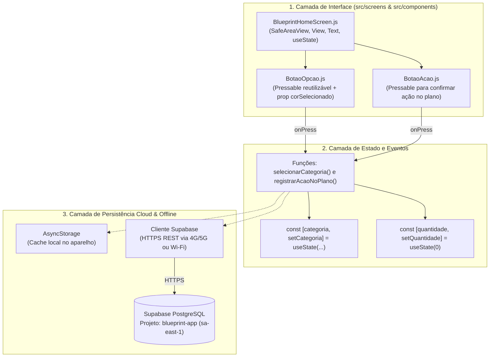
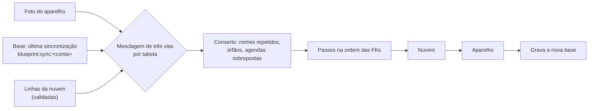

# 🏗️ 02. Arquitetura Técnica, Supabase Cloud e Geração de APK

Este documento detalha a arquitetura do aplicativo **Blueprint**, explicando como a estrutura em **React Native + Expo** se conecta ao banco de dados **Supabase** (provisionado na região `sa-east-1` - São Paulo) e como gerar o instalador **`.apk`** gratuito para celulares Android.

---

## 1. Visão Geral da Arquitetura em Camadas

O projeto foi desenhado em camadas desacopladas para garantir código limpo, fácil manutenção e sincronização eficiente via dados móveis (4G/5G) ou Wi-Fi:



---

## 2. Infraestrutura Cloud no Supabase

O banco de dados na nuvem do **Blueprint** está configurado na região sul-americana para baixa latência:

- **Nome do Projeto:** `blueprint-app`
- **Project Ref:** `jjnubvilupxybafkasuh`
- **Região:** `sa-east-1` (América do Sul — São Paulo)
- **URL da API:** `https://jjnubvilupxybafkasuh.supabase.co`

### Script SQL da Tabela
O arquivo [`src/services/supabaseSchema.sql`](../src/services/supabaseSchema.sql) contém a estrutura da tabela que armazena os registros do aplicativo:

```sql
create table if not exists public.blueprint_actions (
  id uuid default gen_random_uuid() primary key,
  usuario text not null default 'Nilton',
  categoria text not null,
  criado_em timestamp with time zone default now()
);

alter table public.blueprint_actions enable row level security;

create policy "Permitir insercao de acoes no Blueprint"
  on public.blueprint_actions for insert
  with check (true);

create policy "Permitir leitura de acoes no Blueprint"
  on public.blueprint_actions for select
  using (true);
```

### Alerta de segurança: policies abertas

As duas policies acima usam `with check (true)` e `using (true)`. Isso significa que **qualquer pessoa com a chave `anon` pode ler todas as ações de todos os usuários e inserir linhas com qualquer valor de `usuario`**. A chave `anon` é pública por desenho (ela vai embutida no `.apk` e pode ser extraída dele), então a proteção real depende das policies, não do sigilo da chave.

Isso é aceitável apenas enquanto o banco guardar dados de teste. **Antes de publicar o `.apk` ou de ativar o login (Fase 4):**
1. Aplicar a migração proposta em [`src/services/migrations/002_auth_e_rls_PROPOSTA.sql`](../src/services/migrations/002_auth_e_rls_PROPOSTA.sql), que associa cada ação a `auth.uid()` e restringe leitura, inserção e exclusão ao dono;
2. Decidir o destino das linhas antigas (sem `user_id`, ficam invisíveis após a migração);
3. Remover o valor padrão `'Nilton'` da coluna `usuario`, que passa a ser redundante.

A migração **não foi aplicada nem testada** no projeto Supabase. Revise e teste em um projeto de desenvolvimento antes.

---

## 2.1 Banco atual e sincronização offline-first (etapa 5)

O esquema em uso está em [`supabase/migrations/`](../supabase/migrations/): a `001_schema_inicial.sql` (aplicada pelo dono) cria `perfis`, `acoes`, `atividades`, `agendas`, `compromissos`, `avulsos` e o bucket `avatares`, todas com RLS por usuário (`auth.uid() = user_id`) e sem nenhum acesso para `anon`. A tabela `blueprint_actions` descrita acima é do protótipo e não existe no projeto atual. A `002_registros_e_exclusao.sql` (escrita, **não aplicada**) cria `registros` ("Feito" e "Não fui") e troca a policy de exclusão de ações de 5 minutos por "qualquer ação própria".

**Princípios**
- A regra de negócio fica no app; o banco guarda e isola por usuário (RLS).
- O app lê e grava sempre no aparelho (AsyncStorage). A nuvem é uma cópia.
- O cliente usa só a chave **publishable** (`EXPO_PUBLIC_SUPABASE_PUBLISHABLE_KEY`, no `.env`, fora do Git). Sem `.env`, a conta fica indisponível e o app funciona só local.

**Como uma sincronização funciona** (`src/hooks/useSincronizacao.tsx`, regras puras em `src/sincronizacao/`)



1. Baixa todas as linhas da conta (páginas de 1000). Linha inválida é ignorada com aviso.
2. Mescla aparelho e nuvem com a base (regras em `docs/05`, seção 2) e conserta o resultado.
3. Escreve na nuvem nesta ordem: apaga ações, registros, avulsos, compromissos e agendas; apaga atividades que já não são usadas; envia (upsert por `user_id,id`) atividades, agendas, compromissos, avulsos, registros e ações (ações só inserem: `ignoreDuplicates`); apaga as atividades restantes; atualiza o nome em `perfis`.
4. Grava o resultado no aparelho e só então a nova base. Se algo falhar no meio, a base fica como estava e a próxima sincronização recalcula.

Outra conta no mesmo aparelho nunca é misturada: o app pede confirmação e troca os dados. A foto do perfil ainda não sobe (pendente: bucket `avatares`).

**Como aplicar a migração 002**
1. Leia o arquivo inteiro e teste antes em um projeto de desenvolvimento (ou num branch do Supabase).
2. Painel do Supabase > SQL Editor > New query > cole `supabase/migrations/002_registros_e_exclusao.sql` > Run (uma vez só).
3. Rode as consultas do bloco CONFERÊNCIA no fim do arquivo.
4. Abra o app, entre e confira no Perfil "Sincronizado às HH:MM". Antes da 002, o Perfil mostra "O banco precisa da migração 002" e nada é enviado.

**Configuração do Auth no painel (dono)**
- Ligar a proteção contra senhas vazadas (Authentication > Policies/Passwords).
- Confirmar como ficam a confirmação de e-mail e o remetente (o SMTP padrão do Supabase tem limite baixo de envios por hora).
- "Esqueci a senha" envia o link padrão do Supabase, que abre a *Site URL* configurada no painel. O app ainda não trata esse link (não há deep link): a troca da senha precisa de uma página na Site URL ou de um deep link numa etapa futura.

---

## 3. Geração do `.APK` Gratuito para Android

O arquivo [`eas.json`](../eas.json) na raiz do projeto está configurado com `"buildType": "apk"` no perfil `preview`, permitindo gerar um arquivo instalável diretamente nos dispositivos Android sem depender de publicação paga em loja.

### Comandos para Build:
1. Instalar o EAS CLI:
   ```bash
   npm install -g eas-cli
   ```
2. Autenticar na conta Expo:
   ```bash
   eas login
   ```
3. Gerar o `.apk`:
   ```bash
   eas build -p android --profile preview
   ```

---

## 4. Mitigação de Riscos de Implantação

| # | Ponto de Atenção na Implantação | Causa Técnica | Solução Arquitetural Adotada |
| :- | :--- | :--- | :--- |
| **1** | **Conexão em redes móveis (4G/5G) ou Wi-Fi restrito** | O servidor de desenvolvimento local em modo `LAN` exige mesma sub-rede. | Uso de `npx expo start --tunnel` durante testes e build **`.apk`** em produção conectando direto ao Supabase via HTTPS. |
| **2** | **Formato de pacote Android (`.aab` vs `.apk`)** | O build padrão gera *Android App Bundle* restrito à Play Store. | Configuração explícita de `"android": { "buildType": "apk" }` no arquivo [`eas.json`](../eas.json). |
| **3** | **Persistência além da sessão em memória** | O hook `useState` mantém os dados apenas enquanto o ciclo de vida do componente está ativo em memória. | Integração planejada com `AsyncStorage` (offline-first) e sincronização com a tabela `blueprint_actions` no **Supabase**. |
| **4** | **Segurança das chaves de API no repositório** | Chaves expostas em código versionado geram riscos de segurança. | Isolamento das variáveis em `.env` (ignorado via `.gitignore`) e habilitação de *Row Level Security (RLS)* no banco. **Atenção:** o RLS atual está ativo, mas com policies abertas (veja o alerta na seção 2). |
| **5** | **Fonte Nohemi em produção** | Licença comercial paga e arquivo de fonte fora do Expo por padrão. | Confirmar a licença e carregar a fonte com `expo-font`. Manter `Sora` como fallback. |
| **6** | **Sombras e animações no Android** | `elevation` não reproduz o desfoque do iOS e o Reanimated exige configuração de plugin. | Validar em aparelho real e seguir [`04-design-tokens-e-motion.md`](04-design-tokens-e-motion.md). |

---

## 5. Evolução da arquitetura para a v2

| Necessidade | Solução proposta | Fase |
| :--- | :--- | :-: |
| Barra de 4 abas (Hoje, Calendário, Histórico, Perfil) | Biblioteca de navegação por abas (`@react-navigation/bottom-tabs` ou `expo-router`) | 3 |
| Animações da v2 | `react-native-reanimated` | 2 |
| Anel de progresso e gráfico semanal | `react-native-svg` | 2 |
| Tipografia da marca | `expo-font` com Nohemi | 2 |
| Tema claro, escuro e automático | Contexto de tema alimentado por `THEMES` e `useColorScheme()` | 2 |
| Autenticação | Supabase Auth: e-mail e senha prontos (etapa 5); Google e Apple pendentes | 4 |
| Preferências do usuário (tema, fuso, meta, cor de destaque) | Tabela `perfis` com RLS por usuário (migração proposta) | 4 |
| Calendário, histórico e mapa de calor | Consulta agregada por dia no fuso do perfil | 3 |
| Desfazer | Policy de exclusão de qualquer ação própria (migração 002); a regra de quando apagar é do app | 4 |

O modelo de dados completo e as regras de negócio estão em [`05-funcionalidades-e-fluxos.md`](05-funcionalidades-e-fluxos.md).

