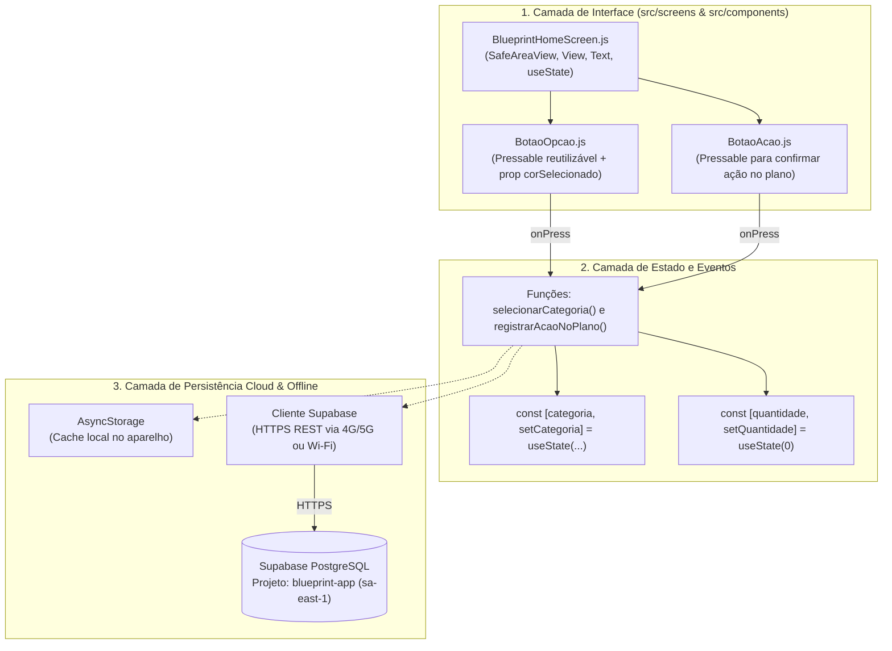

# 🏗️ 02. Arquitetura Técnica, Supabase Cloud e Geração de APK

Este documento detalha a arquitetura do aplicativo **Blueprint**, explicando como a estrutura em **React Native + Expo** se conecta ao banco de dados **Supabase** (provisionado na região `sa-east-1` - São Paulo) e como gerar o instalador **`.apk`** gratuito para celulares Android.

---

## 1. Visão Geral da Arquitetura em Camadas

O projeto foi desenhado em camadas desacopladas para garantir código limpo, fácil manutenção e sincronização eficiente via dados móveis (4G/5G) ou Wi-Fi:



---

## 2. Infraestrutura Cloud no Supabase

O banco de dados na nuvem do **Blueprint** está configurado na região sul-americana para baixa latência:

- **Nome do Projeto:** `blueprint-app`
- **Project Ref:** `jjnubvilupxybafkasuh`
- **Região:** `sa-east-1` (América do Sul — São Paulo)
- **URL da API:** `https://jjnubvilupxybafkasuh.supabase.co`

### Script SQL da Tabela
O arquivo [`src/services/supabaseSchema.sql`](../src/services/supabaseSchema.sql) contém a estrutura da tabela que armazena os registros do aplicativo:

```sql
create table if not exists public.blueprint_actions (
  id uuid default gen_random_uuid() primary key,
  usuario text not null default 'Nilton',
  categoria text not null,
  criado_em timestamp with time zone default now()
);

alter table public.blueprint_actions enable row level security;

create policy "Permitir insercao de acoes no Blueprint"
  on public.blueprint_actions for insert
  with check (true);

create policy "Permitir leitura de acoes no Blueprint"
  on public.blueprint_actions for select
  using (true);
```

### Alerta de segurança: policies abertas

As duas policies acima usam `with check (true)` e `using (true)`. Isso significa que **qualquer pessoa com a chave `anon` pode ler todas as ações de todos os usuários e inserir linhas com qualquer valor de `usuario`**. A chave `anon` é pública por desenho (ela vai embutida no `.apk` e pode ser extraída dele), então a proteção real depende das policies, não do sigilo da chave.

Isso é aceitável apenas enquanto o banco guardar dados de teste. **Antes de publicar o `.apk` ou de ativar o login (Fase 4):**
1. Aplicar a migração [`src/services/migrations/002_auth_e_rls.sql`](../src/services/migrations/002_auth_e_rls.sql) (revisada na Etapa 7), que associa cada ação a `auth.uid()` e restringe leitura, inserção e exclusão ao dono;
2. Decidir o destino das linhas antigas (sem `user_id`, ficam invisíveis após a migração);
3. Remover o valor padrão `'Nilton'` da coluna `usuario`, que passa a ser redundante.

A migração foi **revisada na Etapa 7**, mas **não foi aplicada** pelo app nem pelo assistente: rode-a primeiro em um projeto de desenvolvimento. O app usa a chave **publicável** (`EXPO_PUBLIC_SUPABASE_PUBLISHABLE_KEY`); a chave `anon` é legada e será desativada pelo Supabase até o fim de 2026.

---

## 3. Geração do `.APK` Gratuito para Android

O arquivo [`eas.json`](../eas.json) na raiz do projeto está configurado com `"buildType": "apk"` no perfil `preview`, permitindo gerar um arquivo instalável diretamente nos dispositivos Android sem depender de publicação paga em loja.

### Comandos para Build:
1. Instalar o EAS CLI:
   ```bash
   npm install -g eas-cli
   ```
2. Autenticar na conta Expo:
   ```bash
   eas login
   ```
3. Gerar o `.apk`:
   ```bash
   eas build -p android --profile preview
   ```

---

## 4. Mitigação de Riscos de Implantação

| # | Ponto de Atenção na Implantação | Causa Técnica | Solução Arquitetural Adotada |
| :- | :--- | :--- | :--- |
| **1** | **Conexão em redes móveis (4G/5G) ou Wi-Fi restrito** | O servidor de desenvolvimento local em modo `LAN` exige mesma sub-rede. | Uso de `npx expo start --tunnel` durante testes e build **`.apk`** em produção conectando direto ao Supabase via HTTPS. |
| **2** | **Formato de pacote Android (`.aab` vs `.apk`)** | O build padrão gera *Android App Bundle* restrito à Play Store. | Configuração explícita de `"android": { "buildType": "apk" }` no arquivo [`eas.json`](../eas.json). |
| **3** | **Persistência além da sessão em memória** | O hook `useState` mantém os dados apenas enquanto o ciclo de vida do componente está ativo em memória. | Integração planejada com `AsyncStorage` (offline-first) e sincronização com a tabela `blueprint_actions` no **Supabase**. |
| **4** | **Segurança das chaves de API no repositório** | Chaves expostas em código versionado geram riscos de segurança. | Isolamento das variáveis em `.env` (ignorado via `.gitignore`) e habilitação de *Row Level Security (RLS)* no banco. **Atenção:** o RLS atual está ativo, mas com policies abertas (veja o alerta na seção 2). |
| **5** | **Fonte Nohemi em produção** | Licença comercial paga e arquivo de fonte fora do Expo por padrão. | Confirmar a licença e carregar a fonte com `expo-font`. Manter `Sora` como fallback. |
| **6** | **Sombras e animações no Android** | `elevation` não reproduz o desfoque do iOS e o Reanimated exige configuração de plugin. | Validar em aparelho real e seguir [`04-design-tokens-e-motion.md`](04-design-tokens-e-motion.md). |

---

## 5. Evolução da arquitetura para a v2

| Necessidade | Solução proposta | Fase |
| :--- | :--- | :-: |
| Barra de 4 abas (Hoje, Calendário, Histórico, Perfil) | Biblioteca de navegação por abas (`@react-navigation/bottom-tabs` ou `expo-router`) | 3 |
| Animações da v2 | `react-native-reanimated` | 2 |
| Anel de progresso e gráfico semanal | `react-native-svg` | 2 |
| Tipografia da marca | `expo-font` com Nohemi | 2 |
| Tema claro, escuro e automático | Contexto de tema alimentado por `THEMES` e `useColorScheme()` | 2 |
| Autenticação | Supabase Auth (Google, Apple e e-mail) | 4 |
| Preferências do usuário (tema, fuso, meta, cor de destaque) | Tabela `perfis` com RLS por usuário (migração proposta) | 4 |
| Calendário, histórico e mapa de calor | Consulta agregada por dia no fuso do perfil | 3 |
| Desfazer | Policy de exclusão limitada a ações recentes do próprio usuário | 4 |

O modelo de dados completo e as regras de negócio estão em [`05-funcionalidades-e-fluxos.md`](05-funcionalidades-e-fluxos.md).

