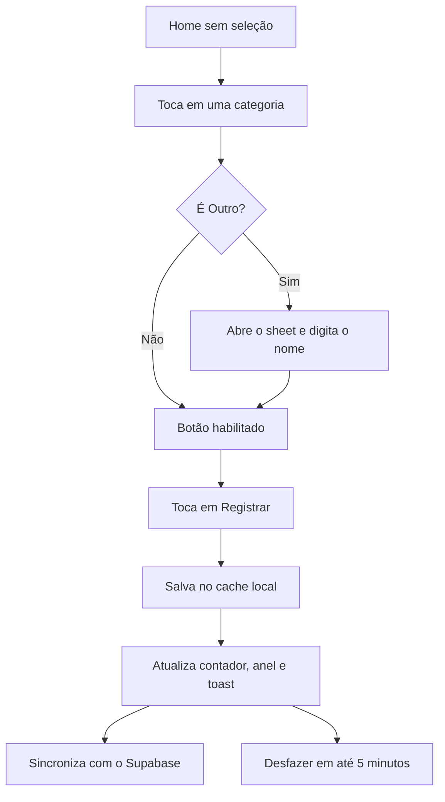
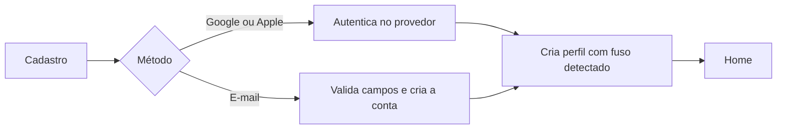

# ⚙️ 05. Funcionalidades, Fluxos e Critérios de Aceite

Lista das funções do **Blueprint**, com a situação real de cada uma e o critério para considerá-la pronta. As telas correspondentes estão em [`03-guia-telas-figma.md`](03-guia-telas-figma.md).

**Legenda de situação**
- ✅ **Implementado:** existe no código de `src/` hoje.
- 🟡 **Parcial:** existe parte da função.
- 🎨 **Desenhado:** especificado no canvas v2, sem código.
- 🧪 **Proposta:** não estava no escopo original e precisa de validação do produto.

---

## 1. Funcionalidades

| ID | Função | Tela | Situação | Fase |
| :-: | :--- | :--- | :--- | :-: |
| F01 | Selecionar uma entre 5 categorias (Hidratação, Exercício, Descanso, Estudo, Outro) | Home | 🟡 Parcial: seleção única com `useState` e `BotaoOpcao` | 2 |
| F02 | Registrar ação da categoria selecionada com 1 toque | Home | 🟡 Parcial: incrementa o contador, mas não valida a categoria (veja a seção 3) | 2 |
| F03 | Contador de ações do dia | Home | 🟡 Parcial: número simples em memória, sem meta | 2 |
| F04 | Anel de progresso com meta diária de 5 ações | Home | 🧪 Desenhado, meta é proposta | 2 |
| F05 | Contador por categoria no cartão ("2 hoje") | Home | 🎨 Desenhado | 2 |
| F06 | "Outro" com nome livre e sugestões rápidas | Home | 🎨 Desenhado (hoje só seleciona a categoria "Outro") | 2 |
| F07 | Toast de confirmação com **Desfazer** | Home | 🧪 Desenhado | 2 |
| F08 | Tema claro, escuro e automático | Home e Perfil | 🎨 Desenhado (`THEMES` existe em `theme.js`, mas nenhuma tela o consome) | 2 |
| F09 | Animações suaves e suporte a "reduzir movimento" | Todas | 🎨 Desenhado | 2 |
| F10 | Navegação por 4 abas | Todas | 🎨 Desenhado | 3 |
| F11 | Calendário mensal com intensidade por dia | Calendário | 🎨 Desenhado | 3 |
| F12 | Resumo do dia selecionado e do mês | Calendário | 🎨 Desenhado | 3 |
| F13 | Histórico semanal em gráfico | Histórico | 🎨 Desenhado | 3 |
| F14 | Resumo: total, dias seguidos, melhor dia | Histórico e Perfil | 🎨 Desenhado | 3 |
| F15 | Lista cronológica de ações por dia (`FlatList`) | Histórico | 🎨 Desenhado | 3 |
| F16 | Histórico em visão mensal (seletor "Mês") | Histórico | 🎨 Controle desenhado, conteúdo da visão mensal ainda não especificado | 3 |
| F17 | Mapa de calor das últimas 12 semanas | Perfil | 🧪 Desenhado | 3 |
| F18 | Cadastro com Nome, E-mail e Senha (mínimo 8 caracteres) | Cadastro | 🎨 Desenhado | 4 |
| F19 | Login com Google e Apple | Cadastro | 🎨 Desenhado | 4 |
| F20 | Fuso horário detectado e editável | Cadastro e Perfil | 🎨 Desenhado | 4 |
| F21 | Editar perfil, cor de destaque (Gradiente, Laranja, Índigo) | Perfil | 🧪 Desenhado | 4 |
| F22 | Persistir ações no Supabase | Todas | 🟡 Tabela criada, app não integrado | 4 |
| F23 | Cache offline com sincronização (`AsyncStorage`) | Todas | 🎨 Planejado | 4 |
| F24 | Gerar `.apk` com EAS | n/a | 🟡 `eas.json` pronto, build não executado | 4 |

---

## 2. Regras de negócio

| Regra | Definição |
| :--- | :--- |
| **Dia** | Intervalo de 00:00 a 23:59 no **fuso horário do perfil**, não do servidor. |
| **Ação** | Um registro com categoria, horário e, para "Outro", um nome de 1 a 40 caracteres. |
| **Meta diária** | 5 ações por padrão, configurável entre 1 e 20 (proposta). O anel tem um segmento por ação da meta. |
| **Excedente** | Ao passar da meta, o anel permanece cheio e o número continua subindo (`6 de 5`). |
| **Sequência** | Dias consecutivos com pelo menos 1 ação. Se hoje ainda não tem registro, a sequência continua válida até a meia-noite e só zera se ontem também estiver vazio. |
| **Melhor dia** | Dia da semana (ou data, na visão mensal) com mais ações no período exibido. Em empate, o mais recente. |
| **Intensidade** | 0, 1 a 2, 3 a 4, 5, 6 ou mais ações, mapeadas para os 4 níveis da rampa de cor. |
| **Desfazer** | Remove a última ação registrada, disponível por 5 minutos (regra reforçada na policy de exclusão da migração proposta). |
| **Desfazer e contadores** | Ao desfazer, contador, anel, calendário e histórico são recalculados. |

---

## 3. Critérios de aceite

### F01 e F02: seleção e registro
- [ ] Ao abrir a Home, nenhuma categoria está selecionada e o botão principal está **desabilitado** com o texto "Escolha uma categoria para registrar".
- [ ] Tocar em uma categoria a destaca (cartão invertido com selo) e habilita o botão com o texto "Registrar {categoria}".
- [ ] Tocar em outra categoria move o destaque. Só uma categoria fica selecionada por vez.
- [ ] Tocar em "Registrar" cria **uma** ação, incrementa o contador do dia e o contador da categoria, anima o anel, mostra o toast e **limpa a seleção**.
- [ ] Toques repetidos e rápidos em "Registrar" não criam registros duplicados além dos tocados (o botão fica desabilitado até a resposta local).

> **Defeito conhecido no código atual:** `registrarAcaoNoPlano()` em `BlueprintHomeScreen.js` incrementa `quantidade` mesmo quando `categoria` ainda é o texto inicial `"Nenhuma categoria selecionada"`, e nunca limpa a seleção. O critério acima corrige os dois pontos.

### F06: "Outro"
- [ ] Tocar em "Outro" abre o bottom sheet com o campo focado.
- [ ] "Registrar ação" só habilita com 1 a 40 caracteres (após remover espaços nas pontas).
- [ ] Tocar em uma sugestão preenche o campo.
- [ ] "Cancelar" ou tocar no fundo fecha o sheet sem registrar nada.

### F07: Desfazer
- [ ] O toast aparece por tempo limitado (sugestão: 5 segundos) e o botão "Desfazer" tem área de toque de pelo menos 44 de altura.
- [ ] Desfazer remove a ação local e, se já sincronizada, a ação no Supabase.

### F08 e F09: tema e movimento
- [ ] "Automático" segue o tema do sistema. "Claro" e "Escuro" ignoram o sistema.
- [ ] A escolha persiste entre sessões.
- [ ] Com "reduzir movimento" ativo no sistema, nenhuma animação de entrada é executada.

### F11 a F15: calendário e histórico
- [ ] O calendário mostra o mês com 5 ou 6 linhas, dias de meses vizinhos em tom secundário e o dia atual destacado.
- [ ] Tocar em um dia atualiza o resumo do dia.
- [ ] Dias futuros não mostram barra de intensidade.
- [ ] Os totais do histórico, do calendário e do perfil usam a mesma regra de "dia" (fuso do perfil) e batem entre si.
- [ ] A lista do histórico é paginada ou virtualizada (`FlatList`) e ordenada da ação mais recente para a mais antiga.

### F18 a F20: cadastro e login
- [ ] Senha com menos de 8 caracteres bloqueia o envio e mostra a mensagem junto ao campo.
- [ ] E-mail inválido mostra erro junto ao campo.
- [ ] O fuso horário é detectado automaticamente (por exemplo com `Intl.DateTimeFormat().resolvedOptions().timeZone`; valide no motor Hermes da versão do Expo usada).
- [ ] Erros de rede mostram mensagem clara e mantêm o que a pessoa digitou.

---

## 4. Fluxos

### Registrar uma ação



### Primeiro acesso



---

## 5. Mapeamento de dados

| Função | Dado | Origem |
| :--- | :--- | :--- |
| Contador, anel e contador por categoria | Ações do dia do usuário | `blueprint_actions`, filtradas pelo dia no fuso do perfil |
| Calendário e mapa de calor | Contagem de ações por dia | Consulta agregada por dia (exemplo abaixo) |
| Histórico semanal | Contagem por dia da semana | Mesma consulta, intervalo de 7 dias |
| Lista do histórico | Ações com horário e categoria | `blueprint_actions` ordenada por `criado_em` |
| Tema, cor de destaque, meta, fuso | Preferências | `perfis` (tabela proposta) |

Exemplo de consulta para o calendário (proposta, não testada no banco real):

```sql
select (a.criado_em at time zone p.fuso)::date as dia, count(*) as acoes
from public.blueprint_actions a
join public.perfis p on p.id = a.user_id
where a.user_id = auth.uid()
  and a.criado_em >= $1
  and a.criado_em <  $2
group by 1
order by 1;
```

A migração que cria `perfis`, adiciona `user_id` e `rotulo` e troca as policies abertas por policies por usuário está em [`src/services/migrations/002_auth_e_rls.sql`](../src/services/migrations/002_auth_e_rls.sql).
