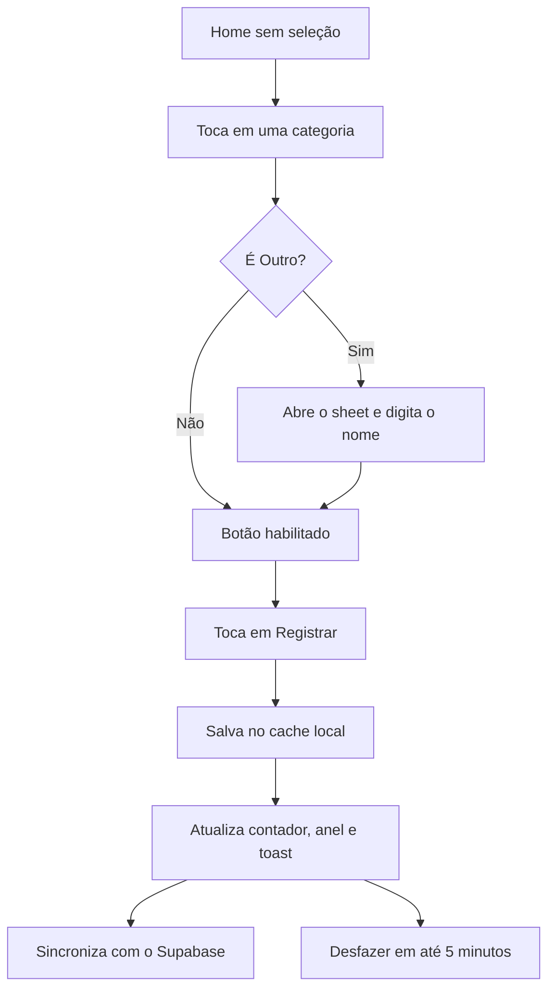
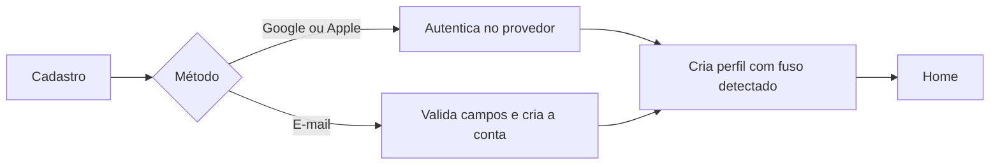

# ⚙️ 05. Funcionalidades, Fluxos e Critérios de Aceite

Lista das funções do **Blueprint**, com a situação real de cada uma e o critério para considerá-la pronta. As telas correspondentes estão em [`03-guia-telas-figma.md`](03-guia-telas-figma.md).

**Legenda de situação**
- ✅ **Implementado:** existe no código de `src/` hoje.
- 🟡 **Parcial:** existe parte da função.
- 🎨 **Desenhado:** especificado no canvas v2, sem código.
- 🧪 **Proposta:** não estava no escopo original e precisa de validação do produto.

---

## 1. Funcionalidades

| ID | Função | Tela | Situação | Fase (A1 a A4: etapas da agenda) |
| :-: | :--- | :--- | :--- | :-: |
| F01 | Seleção e registro rápido por categorias (Hidratação, Exercício, Descanso, Estudo, Outro) | Home | ✅ Implementado: 1 toque no chip registra direto | 2 |
| F02 | Registrar ação com 1 toque no chip e aviso com Desfazer | Home | ✅ Implementado | 2 |
| F03 | Contador de ações do dia no anel compacto | Home | ✅ Implementado | 2 |
| F04 | Anel de progresso com meta diária de 5 ações | Home | 🧪 Desenhado, meta é proposta | 2 |
| F05 | Contador por categoria no cartão ("2 hoje") | Home | 🎨 Desenhado | 2 |
| F06 | "Outro" com nome livre e sugestões rápidas | Home | 🎨 Desenhado (hoje só seleciona a categoria "Outro") | 2 |
| F07 | Toast de confirmação com **Desfazer** | Home | 🧪 Desenhado | 2 |
| F08 | Tema claro, escuro e automático | Home e Perfil | 🎨 Desenhado (`THEMES` existe em `theme.js`, mas nenhuma tela o consome) | 2 |
| F09 | Animações suaves e suporte a "reduzir movimento" | Todas | 🎨 Desenhado | 2 |
| F10 | Navegação por 5 abas (Hoje, Agenda, Calendário, Histórico, Perfil) | Todas | ✅ Implementado (agenda, etapa 1) | 3 |
| F11 | Calendário mensal com intensidade por dia | Calendário | 🎨 Desenhado | 3 |
| F12 | Resumo do dia selecionado e do mês | Calendário | 🎨 Desenhado | 3 |
| F13 | Histórico semanal em gráfico | Histórico | 🎨 Desenhado | 3 |
| F14 | Resumo: total, dias seguidos, melhor dia | Histórico e Perfil | 🎨 Desenhado | 3 |
| F15 | Lista cronológica de ações por dia (`FlatList`) | Histórico | 🎨 Desenhado | 3 |
| F16 | Histórico em visão mensal (seletor "Mês") | Histórico | 🎨 Controle desenhado, conteúdo da visão mensal ainda não especificado | 3 |
| F17 | Mapa de calor das últimas 12 semanas | Perfil | 🧪 Desenhado | 3 |
| F18 | Cadastro com E-mail e Senha (mínimo 8 caracteres, com letras e números, igual ao Supabase Auth); o nome vem do Perfil | Conta | 🟡 Parcial: entrar, criar conta, sair e "Esqueci a senha" por e-mail (etapa 5); a tela desenhada com Nome ainda não | 4 |
| F19 | Login com Google e Apple | Cadastro | 🎨 Desenhado | 4 |
| F20 | Fuso horário detectado e editável | Cadastro e Perfil | 🎨 Desenhado | 4 |
| F21 | Editar perfil, cor de destaque (Gradiente, Laranja, Índigo) | Perfil | 🧪 Desenhado | 4 |
| F22 | Persistir ações, agenda, registros e nome do perfil no Supabase | Todas | 🟡 Parcial: código pronto e testado com nuvem falsa (etapa 5); depende da migração 002 aplicada; foto do perfil ainda só no aparelho | 4 |
| F23 | Offline-first: o app grava no aparelho e sincroniza com a nuvem por mesclagem de três vias | Todas | ✅ Implementado (etapa 5; falta conferir contra o Supabase real) | 4 |
| F24 | Gerar `.apk` com EAS | n/a | 🟡 `eas.json` pronto, build não executado | 4 |
| F25 | Ver a agenda da semana, de domingo a sábado, com navegação entre semanas | Agenda | ✅ Implementado (agenda, etapa 1) | A1 |
| F26 | Criar, editar e remover compromisso recorrente (dias da semana, início, fim opcional, detalhe, aviso antes) | Compromisso | ✅ Implementado (agenda, etapa 1) | A1 |
| F27 | Compromisso avulso de um único dia (o espaço livre "+ Adicionar" do caderno) | Agenda e Compromisso | ✅ Implementado (agenda, etapa 1) | A1 |
| F28 | Agendas por período (por exemplo novembro), criar, editar datas, remover e duplicar para o mês seguinte | Agendas | ✅ Implementado (agenda, etapa 1) | A1 |
| F29 | Editar ou remover "a partir de hoje" numa agenda em curso, sem alterar os dias passados | Compromisso | ✅ Implementado (agenda, etapa 1) | A1 |
| F30 | Catálogo de atividades com categoria opcional (Academia, Corrida em Exercício) | Compromisso | ✅ Implementado (agenda, etapa 1) | A1 |
| F31 | Agenda salva no aparelho, versionada, com dado corrompido guardado à parte | Todas | ✅ Implementado (agenda, etapa 1) | A1 |
| F32 | Registrar "Feito" e "Não fiz" em cada compromisso, com Desfazer; "Feito" gera a ação da categoria | Hoje | ✅ Implementado (agenda, etapa 2; só o dia de hoje) | A2 |
| F33 | Alertas locais: despertar, antecedência por compromisso, botão "Feito" na notificação | Todas e Perfil | ✅ Implementado (agenda, etapa 3; falta conferir em aparelho) | A3 |
| F34 | Painel de histórico por categoria, atividade e mês, com comparação entre meses | Histórico e Hoje | ✅ Implementado (agenda, etapa 4) | A4 |
| F35 | "Avisar antes" com opções de toque (Sem aviso, Na hora, 5, 10, 15, 30 e 60 min), também nos avulsos; permissão de notificação pedida só ao salvar um aviso | Compromisso | ✅ Implementado (ajustes de 2026-11-22) | A3 |
| F36 | Aceite dos Termos de Uso e da Política de Privacidade no cadastro; textos no app e na landing | Conta, Termos, Privacidade | ✅ Implementado (ajustes de 2026-11-22; textos pendentes de revisão jurídica, `docs/09`) | 5 |
| F37 | Excluir a conta e os dados (nuvem e aparelho); sem conta, apagar os dados do aparelho | Perfil | ✅ Implementado (ajustes de 2026-11-22; depende da migração 003, já aplicada) | 5 |

---

## 2. Regras de negócio

| Regra | Definição |
| :--- | :--- |
| **Dia** | Intervalo de 00:00 a 23:59 no **fuso horário do perfil**, não do servidor. |
| **Ação** | Um registro com categoria, horário e, para "Outro", um nome de 1 a 40 caracteres. |
| **Meta diária** | 5 ações por padrão, configurável entre 1 e 20 (proposta). O anel tem um segmento por ação da meta. |
| **Excedente** | Ao passar da meta, o anel permanece cheio e o número continua subindo (`6 de 5`). |
| **Sequência** | Dias consecutivos com pelo menos 1 ação. Se hoje ainda não tem registro, a sequência continua válida até a meia-noite e só zera se ontem também estiver vazio. |
| **Melhor dia** | Dia da semana (ou data, na visão mensal) com mais ações no período exibido. Em empate, o mais recente. |
| **Intensidade** | 0, 1 a 2, 3 a 4, 5, 6 ou mais ações, mapeadas para os 4 níveis da rampa de cor. |
| **Desfazer** | Remove a última ação registrada pelo toast. Desde a migração 002 o banco deixa apagar qualquer ação própria: quando apagar é regra do app (o toast e o "Feito" que vira "Não fiz"). |
| **Desfazer e contadores** | Ao desfazer, contador, anel, calendário e histórico são recalculados. |
| **Registro de compromisso** | No máximo um por compromisso por dia, com status "Feito" ou "Não fiz". Guarda cópia do nome da atividade, da categoria e do horário: editar ou apagar a agenda depois não muda o passado. |
| **Sem registro** | Compromisso não marcado continua "sem registro". Nunca vira "Não fiz" sozinho. |
| **Dia do registro** | Hoje ou dia passado; dia futuro é recusado. A Home marca hoje e ontem; a ação de hábito de um "Feito" de ontem fica datada de ontem, no horário do compromisso. |
| **Painel do mês** | Feitos e "Não fiz" vêm dos registros do mês, inclusive de compromissos que já saíram da agenda. "Sem registro" é o que estava na agenda em dias que já passaram e ninguém marcou; o dia de hoje não conta. Percentual = feitos ÷ (feitos + não fiz + sem registro). |
| **Feito e hábitos** | "Feito" de atividade com categoria também cria uma ação dessa categoria (rótulo só no "Outro", com o nome da atividade). Sair de "Feito" remove essa ação. Atividade sem categoria só gera o registro. |
| **Alerta** | Para compromisso recorrente ou avulso com "Avisar antes" preenchido (0 a 120 minutos; 0 avisa na hora). O despertar é um compromisso comum, sem término e com antecedência 0. Não há alerta para o que já foi marcado no dia. |
| **Avisar antes** | Opções de toque: Sem aviso, Na hora, 5, 10, 15, 30 e 60 minutos. Compromisso novo já vem com 10 minutos; o existente mantém o que tem, inclusive sem aviso. Valor salvo fora da lista (por exemplo 20 ou 120) aparece como opção extra marcada, para não se perder. |
| **Permissão de notificação** | Nunca é pedida ao abrir o app. Ao salvar um compromisso com aviso: se o sistema ainda pode perguntar, o app explica antes ("Para te avisar antes dos compromissos, o Blueprint precisa enviar notificações.") e só pede ao sistema em "Permitir"; se está bloqueada, avisa e oferece abrir as configurações; se já está concedida, não mostra nada. O compromisso é salvo em todos os casos. |
| **Agenda vazia** | O app não traz compromissos prontos. Sem nenhuma agenda, a aba Agenda e a Home dizem que a agenda começa vazia. Os dados de exemplo existem só em desenvolvimento e não entram no APK. |
| **Aceite dos termos** | "Criar conta" só habilita com a caixa "Li e aceito os Termos de Uso e a Política de Privacidade" marcada. O app envia a versão aceita (`termos_versao`); a data do aceite é gravada pelo servidor (migração 003), nunca pelo aparelho. |
| **Excluir a conta** | Perfil > Privacidade, com duas confirmações. Chama `excluir_minha_conta` no banco (apaga registros, ações, avulsos, compromissos, agendas, atividades, perfil e o usuário), sai da conta neste aparelho e apaga os dados locais (ações, agenda, perfil, base de sincronização e dono); os alertas são reagendados para nenhum. Se o banco recusar ou não houver internet, nada é apagado. As preferências de aparência ficam (não são dados pessoais). |
| **Apagar dados do aparelho** | Sem conta, o Perfil oferece apagar ações, agenda, perfil e a base de sincronização deste aparelho, com uma confirmação. |
| **Janela de alertas** | O app agenda os próximos 14 dias (no máximo 120 alertas) e reagenda ao abrir, ao voltar ao primeiro plano e a cada mudança da agenda. Quem ficar mais de 14 dias sem abrir o app para de receber alertas. |
| **Feito na notificação** | Abre o app e marca "Feito" só se o alerta for do dia de hoje; se já estava feito, não desmarca. |
| **Dados no aparelho primeiro** | O app sempre lê e grava no aparelho. A nuvem é uma cópia sincronizada; sem internet nada trava. |
| **Base da sincronização** | Foto (por tabela, id -> conteúdo) da última sincronização bem-sucedida de cada conta, em `blueprint:sync:<id da conta>`. A conta dona dos dados do aparelho fica em `blueprint:dono`. |
| **Mesclagem** | Por tabela, comparando aparelho e nuvem com a base: criado só de um lado vai para o outro; apagado de um lado sai do outro; alterado só de um lado vale esse lado; alterado dos dois lados vale o aparelho. Apagado aqui e alterado lá: apaga. Apagado lá e alterado aqui: a edição volta para a nuvem. Sem base (primeira vez): união, conflito vale o aparelho, nada é apagado. Ações não são editadas: no conflito fica a da nuvem. |
| **Conserto depois da mesclagem** | Atividades com o mesmo nome viram uma só (id da nuvem, conteúdo do aparelho). Atividade apagada aqui e usada por compromisso novo de outro aparelho volta. Agendas sobrepostas: fica a do aparelho. Dois registros do mesmo compromisso no mesmo dia: fica o do aparelho. O resto passa pela mesma validação da leitura do aparelho. |
| **Quando sincroniza** | Ao entrar, ao abrir o app com sessão, ao voltar ao primeiro plano, 2 segundos depois de cada mudança local e no botão "Sincronizar agora". Uma por vez. Sem internet, tenta de novo em 30 segundos. Falha no meio não grava a base: a próxima recalcula (os envios são idempotentes). |
| **Outra conta no aparelho** | Se quem entra não é o dono dos dados do aparelho, nada é misturado: o app pede para trocar os dados pelos da conta que entrou ou cancelar (e sair). Dados sem dono (de antes de entrar) sobem para a primeira conta que entrar. |
| **Sair** | Pergunta se mantém os dados no aparelho. Manter: ficam, e o dono continua o mesmo. Apagar: limpa ações, agenda, perfil e a base deste aparelho (a nuvem fica como está). As preferências de tema continuam. |
| **Leitura do aparelho falhou** | Se a agenda ou as ações não puderam ser lidas na abertura, a sincronização fica pausada até a próxima abertura (senão a tela vazia apagaria a nuvem). |
| **Tocar de novo** | Tocar no status já marcado desmarca. O toast permite desfazer qualquer marcação, voltando registro e ação ao estado anterior. |

---

## 3. Critérios de aceite

### F01 a F03: registro rápido com 1 toque
- [x] Tocar em um chip de categoria padrão (Hidratação, Exercício, Descanso, Estudo) registra imediatamente a ação.
- [x] O chip "Outro" abre o bottom sheet para definir o nome antes de registrar.
- [x] O contador do dia e o anel de progresso atualizam instantaneamente.
- [x] Um toast de aviso com o botão "Desfazer" permite reverter a ação imediatamente.

### F06: "Outro"
- [ ] Tocar em "Outro" abre o bottom sheet com o campo focado.
- [ ] "Registrar ação" só habilita com 1 a 40 caracteres (após remover espaços nas pontas).
- [ ] Tocar em uma sugestão preenche o campo.
- [ ] "Cancelar" ou tocar no fundo fecha o sheet sem registrar nada.

### F07: Desfazer
- [ ] O toast aparece por tempo limitado (sugestão: 5 segundos) e o botão "Desfazer" tem área de toque de pelo menos 44 de altura.
- [ ] Desfazer remove a ação local e, se já sincronizada, a ação no Supabase.

### F08 e F09: tema e movimento
- [ ] "Automático" segue o tema do sistema. "Claro" e "Escuro" ignoram o sistema.
- [ ] A escolha persiste entre sessões.
- [ ] Com "reduzir movimento" ativo no sistema, nenhuma animação de entrada é executada.

### F11 a F15: calendário e histórico
- [ ] O calendário mostra o mês com 5 ou 6 linhas, dias de meses vizinhos em tom secundário e o dia atual destacado.
- [ ] Tocar em um dia atualiza o resumo do dia.
- [ ] Dias futuros não mostram barra de intensidade.
- [ ] Os totais do histórico, do calendário e do perfil usam a mesma regra de "dia" (fuso do perfil) e batem entre si.
- [ ] A lista do histórico é paginada ou virtualizada (`FlatList`) e ordenada da ação mais recente para a mais antiga.

### F18 a F20: cadastro e login
- [ ] Senha com menos de 8 caracteres bloqueia o envio e mostra a mensagem junto ao campo.
- [ ] E-mail inválido mostra erro junto ao campo.
- [ ] O fuso horário é detectado automaticamente (por exemplo com `Intl.DateTimeFormat().resolvedOptions().timeZone`; valide no motor Hermes da versão do Expo usada).
- [ ] Erros de rede mostram mensagem clara e mantêm o que a pessoa digitou.

### F18, F22 e F23: conta e sincronização (etapa 5)
- [ ] Sem `.env` do Supabase, o Perfil mostra "A conta na nuvem não está disponível nesta versão" e o app funciona só no aparelho.
- [ ] Sem conta, o cartão "Conta" do Perfil mostra "Entrar ou criar conta", que abre a tela Conta.
- [ ] Criar conta recusa e-mail inválido e senha com menos de 8 caracteres, com a mensagem junto ao campo, sem chamar o servidor.
- [ ] Com confirmação de e-mail ligada, criar conta avisa "Enviamos um link para ..." e volta para Entrar.
- [ ] Entrar com senha errada mostra "E-mail ou senha incorretos."; e-mail não confirmado e falta de internet têm mensagens próprias; o que foi digitado continua nos campos.
- [ ] "Esqueci a senha" envia o link sem revelar se a conta existe.
- [ ] Depois de entrar, o cartão mostra o e-mail, "Sincronizando" e depois "Sincronizado às HH:MM".
- [ ] Os dados que já estavam no aparelho (sem dono) sobem para a conta na primeira sincronização.
- [ ] Entrar com a mesma conta em outro aparelho traz agenda, registros, ações e nome.
- [ ] Marcar "Feito" num aparelho aparece no outro depois de sincronizar; apagar num aparelho apaga no outro.
- [ ] Sem internet, o app continua funcionando; o cartão mostra "Sem internet: tentaremos de novo" e sincroniza quando a conexão volta.
- [ ] Sem a migração 002 aplicada, o cartão mostra "O banco precisa da migração 002" e o resto do app segue normal.
- [ ] Entrar com outra conta num aparelho com dados de alguém pede confirmação; "Trocar os dados" deixa só os dados da conta nova; "Cancelar e sair" não mexe em nada.
- [ ] "Sair" pergunta se mantém os dados; "Apagar e sair" deixa o app vazio, como na primeira abertura.
- [ ] A foto do perfil continua só no aparelho (pendente: bucket `avatares`).

### F25 a F31: agenda semanal (etapa 1)
- [ ] A aba Agenda mostra a semana de hoje, de domingo a sábado, com o dia de hoje destacado e o intervalo (por exemplo "15 a 21 de novembro").
- [ ] As setas navegam entre semanas, inclusive para o futuro, sem limite.
- [ ] Cada dia lista os compromissos em ordem de horário, mostra "Nada marcado" quando vazio e tem o botão "+ Adicionar".
- [ ] Horários que se sobrepõem no mesmo dia mostram "Conflito de horário"; compromissos que apenas se encostam não.
- [ ] Criar "Toda semana" entra na agenda do período e aparece em todos os dias marcados; "Só neste dia" cria um avulso com a marca "só neste dia" e não altera a agenda.
- [ ] Início é obrigatório; término vazio ou "Sem horário de término" cria evento pontual; término antes ou igual ao início é recusado com a mensagem junto ao botão Salvar.
- [ ] Sem agenda para a data, a tela avisa "Crie uma agenda para este período antes" e leva a Agendas.
- [ ] Editar, criar ou remover um compromisso recorrente numa agenda em curso pergunta "A partir de hoje" ou "O período todo", com aviso de que o segundo muda os dias já passados. "A partir de hoje" não altera nenhum dia anterior.
- [ ] Em agenda que ainda não começou, salvar não pergunta o escopo.
- [ ] Remover pede confirmação.
- [ ] Atividade com nome repetido (sem diferenciar maiúsculas) é recusada; atividade em uso por compromisso não pode ser removida.
- [ ] "Duplicar para o próximo mês" cria o mês de calendário inteiro seguinte, mantém as mesmas atividades e é bloqueado quando o período já tem agenda.
- [ ] Duas agendas nunca se sobrepõem em datas.
- [ ] Fechar o app por completo e reabrir mantém atividades, agendas e avulsos.
- [ ] Dado ilegível no aparelho não derruba o app: a agenda abre vazia e o conteúdo é guardado à parte.

### F32: registro "Feito" e "Não fiz" (etapa 2)
- [ ] A Home mostra "Hoje na agenda" com os compromissos de hoje (recorrentes e avulsos) em ordem de horário e o resumo "Feitos: X de Y".
- [ ] Cada compromisso tem "Feito" e "Não fiz", com 44 de altura e leitor de tela anunciando atividade, horário e se está marcado.
- [ ] "Feito" em atividade com categoria anda o anel e o contador da categoria; em atividade sem categoria, só o resumo da agenda muda.
- [ ] "Não fiz" não conta como feito e não cria ação.
- [ ] Trocar de "Feito" para "Não fiz" remove a ação; tocar de novo no status marcado desmarca.
- [ ] Toda marcação mostra o toast com "Desfazer", que restaura o registro e a ação anteriores (com o mesmo id e horário).
- [ ] Editar a agenda "a partir de hoje" mantém a marcação de hoje.
- [ ] Sem agenda para hoje, aparece "Sem agenda para hoje" com o botão "Montar agenda", que abre a aba Agenda. Com agenda e nada hoje, aparece "Nada marcado para hoje.".
- [ ] Fechar e reabrir o app mantém as marcações. A agenda gravada na versão 1 abre sem perda, com a lista de registros vazia.

### F33: alertas locais (etapa 3)
- [ ] No Perfil, o cartão "Alertas da agenda" mostra se os alertas estão ligados, desligados (com "Permitir alertas") ou bloqueados (com "Abrir configurações").
- [ ] Com permissão, um compromisso com "Avisar antes" de 15 minutos toca 15 minutos antes, com o app fechado e a tela bloqueada, inclusive às 04:30.
- [ ] O alerta mostra "{Atividade} às {HH:MM}", "Começa em 15 min." ou "Está na hora." e o detalhe do compromisso.
- [ ] O botão "Feito" da notificação abre o app com o compromisso marcado como feito e o anel atualizado.
- [ ] Marcar "Feito" ou "Não fiz" no app cancela o alerta daquele compromisso no dia.
- [ ] Editar ou remover um compromisso reagenda os alertas em menos de 1 segundo.
- [ ] No Android, o aviso de bateria aparece com o atalho para as configurações do app.
- [ ] Só pode ser conferido em development build ou APK (`eas.json`, perfis `development` ou `preview`), não no Expo Go.

### F35: avisar antes e permissão (ajustes de 2026-11-22)
- [ ] O formulário de compromisso mostra "Avisar antes" com Sem aviso, Na hora, 5 min, 10 min, 15 min, 30 min e 1 h, cada opção com 44 de altura e anunciada como opção marcada ou não.
- [ ] Compromisso novo abre com 10 min marcado; editar um compromisso sem aviso mostra "Sem aviso".
- [ ] "Só neste dia" também tem o aviso, e o alerta do avulso toca como o dos recorrentes.
- [ ] Abrir o app pela primeira vez não pede permissão de notificação.
- [ ] Salvar com aviso e permissão ainda não pedida: aparece a explicação com "Agora não" e "Permitir"; só "Permitir" abre o pedido do sistema.
- [ ] Salvar com aviso e notificações bloqueadas: aparece o aviso com "Abrir configurações".

### F36 e F37: termos, privacidade e exclusão (ajustes de 2026-11-22)
- [ ] Em Criar conta, a caixa de aceite começa desmarcada e "Criar conta" fica desabilitado até marcar.
- [ ] "Termos de Uso" e "Política de Privacidade" abrem os textos no app, mesmo sem internet; o Perfil também tem os dois links.
- [ ] Depois do cadastro, `perfis.termos_versao` tem a versão aceita e `termos_aceitos_em` a hora do servidor.
- [ ] Com conta, "Excluir minha conta e dados" pede duas confirmações; ao confirmar, a conta some do Supabase, o app sai da conta e fica vazio, com a mensagem de confirmação.
- [ ] Sem internet, a exclusão mostra o erro e nada é apagado.
- [ ] Sem conta, "Apagar dados deste aparelho" pede confirmação e deixa o app vazio.

### F34: painel de compromissos (etapa 4)
- [ ] Histórico > Mês mostra "Compromissos da agenda" com feitos, não fiz, sem registro e "Cumpriu X% do que estava na agenda.".
- [ ] Um cartão por categoria (e "Sem categoria"), com o total do mês e uma linha por atividade: "Academia, 18 vezes, 3 a mais que no mês anterior".
- [ ] Tocar na atividade abre os dias: "Feito: 2, 5 e 7 de novembro", "Não fiz: …", "Sem registro: …".
- [ ] Editar ou apagar a agenda depois não muda a contagem de meses passados.
- [ ] Na Home, "Hoje | Ontem" permite marcar os compromissos de ontem.

---

## 4. Fluxos

### Registrar uma ação



### Primeiro acesso



---

## 5. Mapeamento de dados

| Função | Dado | Origem |
| :--- | :--- | :--- |
| Sincronização (etapa 5) | Ações, atividades, agendas, compromissos, avulsos, registros e o nome do perfil | Tabelas `acoes`, `atividades`, `agendas`, `compromissos`, `avulsos`, `registros` e `perfis` (`supabase/migrations/001` e `002`). O app guarda a cópia local e calcula tudo no aparelho. |
| Contador, anel e contador por categoria | Ações do dia do usuário | `acoes`, filtradas pelo dia no fuso do perfil |
| Calendário e mapa de calor | Contagem de ações por dia | Consulta agregada por dia (exemplo abaixo) |
| Histórico semanal | Contagem por dia da semana | Mesma consulta, intervalo de 7 dias |
| Lista do histórico | Ações com horário e categoria | `acoes` ordenada por `criado_em` |
| Tema, cor de destaque, meta, fuso | Preferências | `perfis` (tabela proposta) |

Exemplo de consulta para o calendário (proposta, não testada no banco real):

```sql
select (a.criado_em at time zone p.fuso)::date as dia, count(*) as acoes
from public.acoes a
join public.perfis p on p.id = a.user_id
where a.user_id = auth.uid()
  and a.criado_em >= $1
  and a.criado_em <  $2
group by 1
order by 1;
```

O esquema atual, com `perfis`, `user_id` em todas as tabelas e RLS por usuário, está em [`supabase/migrations/`](../supabase/migrations/).
